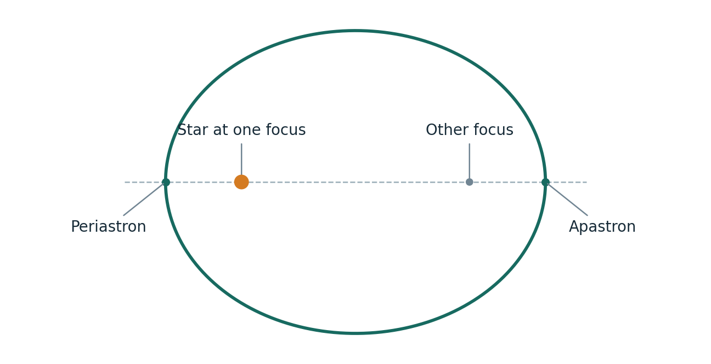
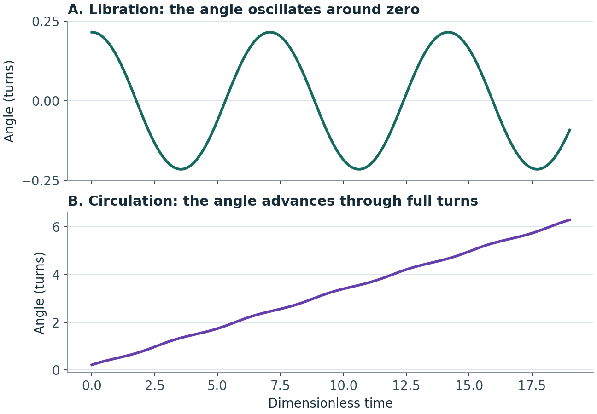
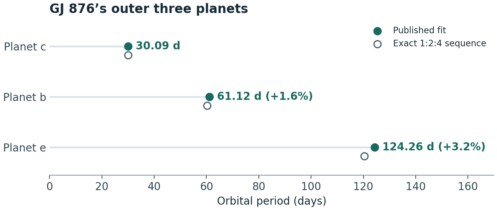

# Chapter 2 - Orbital Dynamics of Exoplanets

## 2.1 An orbit is a prediction

The orbits of Jupiter and Saturn look almost like ellipses over one revolution. Over longer times, the planets move one another. The same distinction matters when we find a pair of exoplanets that take nearly two and one orbits, respectively, to go around their star. They may be dynamically locked together, or the period ratio may be a coincidence. To tell, we need to predict when they meet and how those encounters change their motion.

This chapter starts with the two-body orbit and then asks three research questions. Which planet pairs are truly in resonance? How might a resonant system have formed? What can a tilted orbit tell us about a planet’s history? Konstantin Batygin’s work provides examples of how to turn each question into a model that observations can test.

## 2.2 The two-body orbit

A star and planet orbit their common center of mass. In the relative orbit, the vector $\mathbf r$ points from the star to the planet. For two isolated spherical bodies with masses $M_\star$ and $M_p$, Newton’s law gives

$$
\ddot{\mathbf r}=-\frac{\mathcal G}{r^3}\mathbf r,
\qquad
\mathcal G=G(M_\star+M_p).
$$

The separation $r$ varies along the orbit. For an ellipse of semimajor axis $a$ and eccentricity $e$, the closest and farthest separations are $a(1-e)$ and $a(1+e)$. The star lies at a focus when we draw the relative orbit. The planet’s orbital plane remains fixed because the central force exerts no torque on the relative motion.

<figure class="orbit-figure">
  
  <figcaption><strong>Kepler’s first law.</strong> This relative orbit has an eccentricity of 0.6. The star sits at one focus of the ellipse. Periastron and apastron mark the nearest and farthest points from the star.</figcaption>
</figure>

<figure class="orbit-figure">
  <iframe src="/books/Exoplanets/chapters/assets/equal-areas.html"
    title="Interactive orbit demonstrating Kepler’s second law"
    width="100%" height="405" loading="lazy"></iframe>
  <figcaption><strong>Equal time, equal area.</strong> Each shaded sector takes one-twelfth of an orbit to sweep out. Play the animation or move the slider. Near periastron, the planet covers a longer arc in the same time because it moves faster. At apastron, the line from the star to the planet is longer, so a shorter arc can sweep out the same area.</figcaption>
</figure>

Kepler’s third law gives a scale for the orbit:

$$
P^2=\frac{4\pi^2a^3}{\mathcal G}.
$$

**Worked example.** A planet on a 10-day orbit around a one-solar-mass star has $a\simeq0.091$ AU if its mass is negligible compared with the star’s. If $e=0.6$, it ranges from about 0.036 to 0.145 AU. The distances differ by a factor of four, so the incident stellar flux differs by a factor of sixteen if the star’s luminosity stays fixed. That flux ratio describes the changing irradiation. The atmospheric temperature response also depends on how quickly the planet absorbs, transports, and reradiates heat.

### What stays constant?

The specific orbital energy $\mathcal E$ and specific angular momentum $\mathbf h$ are measured per unit reduced mass. With $\mathbf v=\dot{\mathbf r}$,

$$
\mathcal E=\frac{v^2}{2}-\frac{\mathcal G}{r}
=-\frac{\mathcal G}{2a},
\qquad
\mathbf h=\mathbf r\times\mathbf v,
\qquad
h^2=\mathcal G a(1-e^2).
$$

The area swept per unit time is $h/2$. At periastron and apastron the velocity is transverse, so $rv=h$. For the example above, the speed ratio is $(1+e)/(1-e)=4$. The same energy relation gives the **vis-viva equation** $v^2=\mathcal G(2/r-1/a)$. Negative specific energy corresponds to a bound orbit. In the ideal point-mass problem, zero energy gives a parabolic escape trajectory and positive energy a hyperbolic one.

## 2.3 From orbital elements to measurements

Orbital elements describe both the shape of an ellipse and how it is viewed. The inclination $i$ is measured to the plane of the sky, so $90^\circ$ is edge-on. The longitude of the ascending node $\Omega$ orients the line where the orbit crosses that plane. The argument of periastron $\omega$ locates closest approach in the orbital plane, measured from the ascending node. An epoch, such as the time of periastron, specifies where the planet is in its cycle. In a perfectly circular orbit, the direction of periastron is undefined, so a reference phase is more useful.

| Measurement | What orbital geometry contributes |
| --- | --- |
| [Transit photometry](#Chapter3) | Repeated dips give the period and transit times. The transit duration and shape constrain the projected chord, with dependencies on eccentricity and stellar size. |
| [Radial velocity](#Chapter5) | The component of the star’s reflex velocity along the line of sight constrains a projected mass. Eccentricity and orientation can change the curve’s shape. |
| Direct imaging or astrometry | Repeated sky-plane positions can constrain projected orientation and, with enough coverage or complementary velocities, the three-dimensional orbit. |
| Transit timing variations | Changes in the timing of successive transits can reveal gravitational interactions, including those with a companion that is difficult to detect independently. |

For a circular orbit with randomly oriented orbital poles, a transit occurs if the projected separation at conjunction is within $R_star+R_p$, where $R_star$ and $R_p$ are the stellar and planetary radii. The geometric probability is $(R_star+R_p)/a$. For the 10-day example, a Sun-sized star and a small planet give a probability of about 5%. In an eccentric orbit, the separation at conjunction also depends on periastron orientation. This geometric selection is one reason a [transit catalog needs a completeness correction](#Statistics/Chapter1).

### Turn an observation time into a position

At time $t$, compute the **mean anomaly** $M=2\pi(t-t_{\rm peri})/P$, where $t_{\rm peri}$ is the time of periastron. This angle advances uniformly in time. Solve Kepler’s equation $M=E-e\sin E$ for the **eccentric anomaly** $E$. The true anomaly $\nu$, the actual angle from periastron, follows from

$$
\nu=2\operatorname{atan2}\!\left(
\sqrt{1+e}\sin(E/2),\sqrt{1-e}\cos(E/2)
\right),
\qquad
r=a(1-e\cos E).
$$

Use the [Numerical Methods root-finding lab](#NumericalMethods/Chapter1) to solve this equation. Its eccentric example moves about $107^\circ$ in the first tenth of an orbit after periastron. Check the circular limit $E=M$ and verify that changing the solution tolerance has little effect on the predicted observable. [Fulton et al. (2018), RadVel](https://doi.org/10.1088/1538-3873/aaaaa8)

## 2.4 A period ratio raises a question about resonance

Consider two planets with periods close to 10 and 20 days. In an exact, unperturbed 2:1 commensurability they would meet at the same orbital longitude on successive conjunctions. In an interacting system, a mean-motion resonance can keep the timing of those meetings tied to the orientation of the ellipses. The gravitational kicks then depend on a phase that does not freely sweep through all angles.

A ratio near 2:1 is a good place to look for this behavior. To identify resonance, check the **resonant angles** in an interacting fit. For a planar pair near the first-order $j:(j-1)$ commensurability, examples are

$$
\phi_i=j\lambda_2-(j-1)\lambda_1-\varpi_i,
\qquad i=1,2.
$$

Here subscripts 1 and 2 denote the inner and outer planets, $\lambda=M+\varpi$ is mean longitude in the plane, and $\varpi$ is longitude of periastron. An appropriate resonant angle can **librate**, oscillating around a preferred value, or **circulate**, passing through every phase. The combination of longitudes matters because the periastra can themselves precess. The observed period ratio alone does not determine how the angles behave. [Batygin (2015), *Capture of Planets into Mean-Motion Resonances*](https://doi.org/10.1093/mnras/stv1063)

<figure class="orbit-figure">
  
  <figcaption><strong>How to read a resonant angle.</strong> These are two numerical trajectories of a dimensionless pendulum model for the angular behavior near resonance. One remains bounded, while the other completes successive turns. The angle is plotted without wrapping so the full turns stay visible. The curves illustrate the diagnostic and do not represent an observed planetary system.</figcaption>
</figure>

### Why a pendulum helps, and where it stops helping

A simple local resonance model has a periodic angle-dependent interaction and a restoring torque. The dimensionless pendulum, $\ddot\phi=-\sin\phi$, illustrates the distinction between bounded and circulating motion. A separatrix divides the two kinds of trajectories. Planetary resonances have additional degrees of freedom, including the eccentricities of the orbits. Batygin retained both planet masses and eccentricities in a first-order Hamiltonian model to study when a migrating pair gets captured. The pendulum diagram explains what an angle can do. Capture probabilities and libration widths require the physical resonance model. [Batygin (2015)](https://doi.org/10.1093/mnras/stv1063)

## 2.5 Research dilemma: why are so many pairs just wide of resonance?

A gas disk can change planetary orbits by exchanging angular momentum with the planets. If the outer orbit approaches the inner one in relative terms, the period ratio can sweep across a resonance. A pair with sufficiently slow convergent migration and small initial eccentricities can be captured. Capture depends on the migration rate, planet masses, and the initial orbital state. Two planets crossing the same period ratio need not end up in the same dynamical state. [Batygin (2015)](https://doi.org/10.1093/mnras/stv1063)

Some Kepler pairs sit just wide of low-order ratios such as 2:1. Batygin and Alessandro Morbidelli showed how dissipation can widen a pair’s period ratio away from nominal commensurability. Lithwick and Wu developed a related explanation called **resonant repulsion**. Near resonance, interactions force eccentricities, and damping dissipates orbital energy. The orbits can spread as they respond to that loss. Convergent migration followed by capture and damping is one explanation. Deck and Batygin showed that under some conditions, libration can grow until the pair escapes resonance during migration. The present period ratio can therefore reflect several different histories. [Batygin & Morbidelli (2013)](https://doi.org/10.1088/0004-6256/145/1/1) · [Lithwick & Wu (2012)](https://arxiv.org/abs/1204.2555) · [Deck & Batygin (2015)](https://doi.org/10.1088/0004-637X/810/2/119)

**Research problem.** A transiting pair has periods of 10.0 and 20.4 days. Near 2:1, the leading slow timing variation can have a characteristic period

$$
P_{\rm super}=\left|\frac{2}{P_2}-\frac{1}{P_1}\right|^{-1}.
$$

These periods give **510 days**. A six-month baseline covers only about a third of that timescale. A slow drift in transit times may constrain the signal poorly. Collect timings across more than one cycle and consider independent radial velocities because the timing amplitudes can mix effects from mass and free eccentricity. For a pair that is actually resonant, the dynamics can introduce a libration timescale distinct from this near-commensurability estimate. To determine whether the pair is locked now, integrate plausible orbital fits and inspect the angles. Inferring the original formation pathway also requires checking whether the proposed migration and damping histories reproduce the observed architecture. [Lithwick, Xie & Wu (2012)](https://doi.org/10.1088/0004-637X/761/2/122)

## 2.6 GJ 876: can a resonant system be chaotic?

Radial-velocity observations of GJ 876 revealed a fourth planet, e, outside the giant planets c and b. The outer three have fitted periods close to 30, 61, and 124 days. Rivera and colleagues fitted the interacting orbits and found that the three-body **Laplace angle**

$$
\phi_{\rm L}=\lambda_c-3\lambda_b+2\lambda_e
$$

librates around zero in their best-fit model. The combination is slow because c completes roughly four revolutions and b roughly two while e completes one. The libration is the dynamical result. Three near-integer periods are only a clue. [Rivera et al. (2010)](https://doi.org/10.1088/0004-637X/719/1/890)

<figure class="orbit-figure">
  
  <figcaption><strong>Three fitted periods in GJ 876.</strong> The colored points use the osculating periods from a published four-planet fit. These are the periods associated with the fitted ellipses at the model’s reference epoch. The hollow markers show exact multiples of planet c’s period for comparison. Establishing the Laplace resonance requires following the three-body angle in the interacting model. <a href="https://doi.org/10.1088/0004-637X/719/1/890">Rivera et al. (2010), Table 3</a>.</figcaption>
</figure>

Batygin, Katherine Deck, and Matthew Holman examined why this resonant system can also exhibit **chaos**. Nearby initial conditions can separate rapidly even while the planets remain confined to a resonant configuration. Their model connected the chaos to interacting resonant degrees of freedom. They found that adding modest stochastic forcing during disk migration helped reproduce aspects of the inferred configuration in their simulations. This provides a hypothesis about the early disk. The turbulence itself was not measured by the radial velocities. [Batygin, Deck & Holman (2015)](https://doi.org/10.1088/0004-6256/149/5/167)

**Research dilemma.** A smooth migration model and a model with turbulent forcing can both produce near-integer ratios. Compare their predictions for libration amplitudes, orbital eccentricities, and the long-term behavior of an ensemble of fits. A short Lyapunov time, the characteristic time for nearby trajectories to diverge, limits precise phase predictions. To establish how long the system stays bound, also test for close encounters, orbit crossing, or escape on longer timescales.

## 2.7 Why are some hot Jupiters tilted?

Some hot Jupiters orbit far from their stars’ equatorial planes. An inclined distant companion can alter the inner orbit’s inclination and eccentricity through **secular** interactions, which accumulate over many orbital periods. If the eccentricity becomes large, repeated close passages can dissipate energy through tides and shrink the orbit. This is one proposed route to a short-period, misaligned giant planet. [Fabrycky & Tremaine (2007)](https://doi.org/10.1086/521702)

Batygin proposed a different starting point. An inclined companion can torque a young protoplanetary disk. If the disk tilts relative to the stellar spin, planets can migrate within that disk and inherit its misalignment. A tilted hot Jupiter could therefore record a tilted formation environment or subsequent orbital evolution. Both mechanisms have conditions on the strength of the torque, the system architecture, and how long the relevant processes act. [Batygin (2012), *A Primordial Origin for Misalignments Between Stellar Spin Axes and Planetary Orbits*](https://doi.org/10.1038/nature11560)

**Research dilemma.** The Rossiter–McLaughlin effect measures the sky-projected spin–orbit angle for a transiting planet. An ensemble of planets sharing a tilted plane would support a shared origin for the tilt, although it would not uniquely identify its cause. Mutual inclinations, outer companions, stellar ages, and the efficiency of stellar tidal realignment can all change the interpretation. The observed angle is a projection. Inferring the true angle requires the stellar spin inclination as well as the orbital inclination and projected angle. [Chapter 5: The Radial Velocity Method](#Chapter5) · [Dawson & Johnson (2018), *Origins of Hot Jupiters*](https://doi.org/10.1146/annurev-astro-081817-051853)

## 2.8 Test a dynamical explanation

1. Fit a Keplerian baseline to the actual observation times and quantify uncertainties, including instrument offsets and stellar noise.
2. Where interactions matter, fit or integrate an ensemble of Newtonian $N$-body models. Inspect the resonant angles and precession over a window long enough to distinguish a slow drift from a bounded oscillation.
3. Repeat with tighter numerical settings. In a conservative integration, monitor energy and total angular momentum. When including disk forces or tides, check the expected energy and angular-momentum budget instead. Compare statistical properties across integrations when chaos makes individual phases diverge.
4. Predict the measurement that best separates the explanations. It might be a transit during a poorly sampled part of the timing cycle, a new radial-velocity season, or a measurement of a companion’s orbit.

REBOUND provides open-source $N$-body integrators for this kind of numerical experiment. Start with a two-body orbit to validate units and coordinates, then add the interactions required by the research question. [Rein & Liu (2012)](https://doi.org/10.1051/0004-6361/201118085) · [REBOUND source code](https://github.com/hannorein/rebound)
