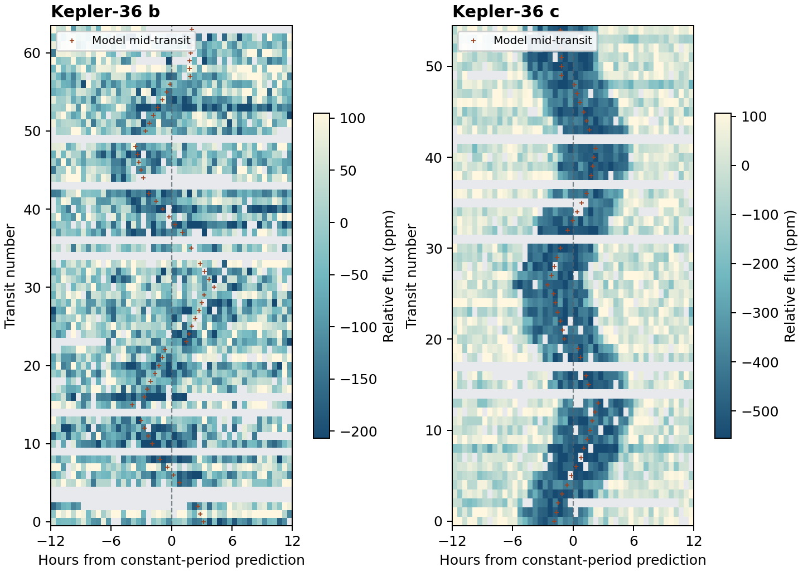
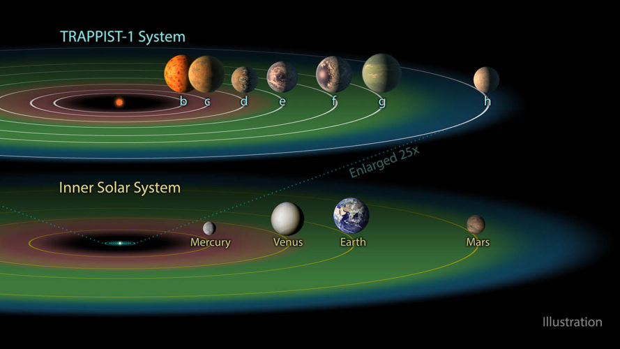

# Chapter 3 - Transits and Occultations

## 3.1 Shadows and Light

<figure style="float: right; width: 35%; margin: 0 0 1rem 1.5rem;">
  
  <figcaption style="font-size: 0.85rem; color: #555; margin-top: 0.4rem;">
    Schematic top and side views of a transiting multiplanet system, illustrating planets of different sizes as they pass in front of their host star. [Image credit: Wikipedia; Aspolanski.]
  </figcaption>
</figure>

If Chapter 1 introduced the existence of other worlds, this chapter explains how we learned to weigh and measure them without ever seeing them directly.

A transit occurs when a planet passes in front of its host star, temporarily blocking a small fraction of starlight. An occultation (also called a secondary eclipse) occurs when the planet passes behind the star, briefly removing the planet’s own emitted and reflected light from view.

These events are subtle. A Jupiter-sized planet transiting a Sun-like star blocks about 1% of the starlight. An Earth-sized planet blocks only 0.01%. Yet from these tiny changes in brightness, we can measure planetary radii, orbital geometries, atmospheric compositions, temperatures, albedos, and even maps of distant worlds.

Add more text carefully

The method is conceptually simple: measure brightness versus time. The interpretation, however, is rich with physics.

---

## 3.2 The Geometry of a Transit

Transits require a special alignment. The orbital plane of the planet must be nearly edge-on to our line of sight. The probability of this alignment is approximately

\[
P_{\rm transit} \approx \frac{R_\star + R_p}{a},
\]

where \( R_\star \) is the stellar radius, \( R_p \) the planetary radius, and \( a \) the orbital distance.

Close-in planets are therefore much more likely to transit than distant ones. This geometric bias explains why many of the first detected transiting planets were hot Jupiters.

When a transit occurs, the fractional loss of light—known as the **transit depth**—is approximately

\[
\delta \approx \left( \frac{R_p}{R_\star} \right)^2.
\]

From this single number, we obtain the planet’s radius relative to its star.

But the light curve contains much more information than just its depth.

### Deriving the transit probability for an eccentric orbit

Let \(e\) be eccentricity, \(f\) true anomaly, \(\omega\) the planet’s argument of periapsis, and \(i=90^\circ\) an edge-on orbit. For a nearly edge-on orbit, inferior conjunction occurs near \(f+\omega=\pi/2\). Substituting into the orbital separation and projecting onto the sky gives the impact parameter in units of the stellar radius,

\[
r_{\rm tr} \simeq \frac{a(1-e^2)}{1+e\sin\omega},
\qquad b_{\rm tr}\simeq\frac{r_{\rm tr}}{R_\star}|\cos i|.
\]

With \(k=R_p/R_\star\), the disks overlap when \(b_{\rm tr}<1+k\). For isotropic orientations, \(|\cos i|\) is uniform from zero to one, so the probability is the length of the allowed interval. For a detached orbit this gives

\[
P_{\rm tr}\simeq \frac{R_\star+R_p}{a}\frac{1+e\sin\omega}{1-e^2}.
\]

A full transit requires \(b_{\rm tr}<1-k\) for \(k<1\). At fixed \(a\) and \(e\), a conjunction near periapsis makes a transit visible over a wider range of viewing angles. Setting \(e=0\) recovers the circular result. [Winn (2010), §2, Eqs. 6–10](https://arxiv.org/pdf/1001.2010#page=3)

---

## 3.3 Anatomy of a Transit Light Curve

A transit light curve has a characteristic shape:

- **Ingress** — the planet begins to cross the stellar disk  
- **Full transit** — the planet is fully superimposed on the star  
- **Egress** — the planet exits the stellar disk  

The duration of the transit depends on the orbital speed and geometry. The shape encodes:

- The planet’s radius \( R_p \)
- The orbital inclination \( i \)
- The scaled semi-major axis \( a/R_\star \)
- The impact parameter \( b \)

The transit shape can constrain the star’s mean density. The depth and the lengths of ingress, full transit, and egress help determine how far the planet travels across the disk. With the orbital period and an orbital model, that geometry gives the stellar density.

### From contact times to stellar density

For a circular orbit set \(A=a/R_\star\), \(b=A\cos i\), and \(\phi=2\pi(t-t_c)/P\), where \(t_c\) is mid-transit. The two sky-plane coordinates in stellar radii are \(A\sin\phi\) and \(b\cos\phi\). Squaring and adding gives the projected separation \(z\),

\[
z^2=b^2+(A^2-b^2)\sin^2\phi.
\]

At first and fourth contact the disks are externally tangent, so \(z=1+k\). At second and third contact they are internally tangent, so \(z=1-k\). The contacts occur symmetrically around \(t_c\), giving

\[
T_{14,23}=\frac{P}{\pi}\arcsin\sqrt{\frac{(1\pm k)^2-b^2}{A^2-b^2}}.
\]

Use the plus sign for total duration \(T_{14}\) and the minus sign for full duration \(T_{23}\). A grazing transit has no second or third contact. For a well-resolved full transit, define \(S_{14}=\sin^2(\pi T_{14}/P)\) and \(S_{23}=\sin^2(\pi T_{23}/P)\). Subtracting the two contact equations eliminates \(b^2\) from their numerators,

\[
A^2-b^2=\frac{4k}{S_{14}-S_{23}},
\qquad b^2=(1+k)^2-S_{14}(A^2-b^2).
\]

Kepler’s third law, \(4\pi^2a^3/(GP^2)=M_\star+M_p\), then yields the mean stellar density for \(M_p\ll M_\star\),

\[
\rho_\star\simeq\frac{3\pi}{GP^2}A^3.
\]

In a real fit, limb darkening and finite exposure times affect how accurately \(k\) and the contact times can be inferred. [Winn (2010), Eqs. 14–15 and 30](https://arxiv.org/abs/1001.2010)

### How eccentricity biases a circular density estimate

For a short transit near edge-on conjunction, the orbital velocity in the sky plane along the chord is approximately the tangential speed \(h/r_{\rm tr}\). The specific angular momentum is \(h=(2\pi/P)a^2\sqrt{1-e^2}\). Dividing \(h/r_{\rm tr}\) by the circular speed \(2\pi a/P\) gives

\[
g=\frac{1+e\sin\omega}{\sqrt{1-e^2}}.
\]

For a fixed transit chord the duration scales as \(1/(gA)\). In the short-transit limit a circular fit can absorb that speed change into \(A_{\rm circ}\simeq gA\), and the inferred density therefore scales as \(\rho_{\rm circ}\simeq g^3\rho_\star\). For example, \(e=0.2\) and \(\omega=90^\circ\) give \(g\simeq1.225\), so a circular fit overestimates the stellar density by about 84%. An independent stellar density can constrain \(g\), which combines \(e\) and \(\omega\). [Winn (2010), Eqs. 16 and 30](https://arxiv.org/abs/1001.2010)

---

## 3.4 Limb Darkening: The Star Is Not Uniform

Stars are not uniform disks. Their edges appear dimmer than their centers—a phenomenon known as **limb darkening**. This effect arises because we see deeper, hotter layers at the center of the stellar disk and shallower, cooler layers near the edge.

<iframe 
  src="/books/Exoplanets/chapters/assets/limbdarkening.html" 
  width="100%" 
  height="520" 
  style="border:none; border-radius:12px; margin: 2rem 0;">
</iframe>

Accurate modeling of limb darkening is essential for precise transit parameter estimation. The light curve is subtly distorted by the stellar intensity profile. For high signal-to-noise observations, even small mismatches between assumed and actual limb darkening can bias inferred planetary radii.

### Deriving the depth correction for limb darkening

Let \(\mu\) be the cosine of the angle between the local stellar surface normal and the line of sight. For the quadratic law \(I(\mu)/I(1)=1-u_1(1-\mu)-u_2(1-\mu)^2\), the projected annuli weight the disk average by \(2\mu\,d\mu\). The linear and quadratic terms integrate to \(1/3\) and \(1/6\), respectively, giving

\[
\frac{\langle I\rangle}{I(1)}
=2\int_0^1\frac{I(\mu)}{I(1)}\mu\,d\mu
=1-\frac{u_1}{3}-\frac{u_2}{6}.
\]

A small planet fully inside the disk blocks approximately its projected area times the local intensity. Divide by the stellar disk area times its average intensity to obtain the mid-transit depth,

\[
\delta_{\rm mid}\simeq k^2\,\frac{I(\sqrt{1-b^2})}{\langle I\rangle}.
\]

The same radius ratio can therefore produce a deeper transit across the bright center than along a chord close to the limb. Near ingress or egress, or for a large planet, integrate the intensity over the actual overlap area. [Winn (2010), §2.5](https://arxiv.org/pdf/1001.2010#page=5)

---

## 3.5 Occultations: Measuring Planetary Light

During occultation, the planet disappears behind the star. The observed decrease in total flux is typically much smaller than during transit because we are removing only the planet’s light, not the star’s.

The depth of the occultation tells us:

- The planet’s thermal emission (at infrared wavelengths)
- The planet’s reflected light (at optical wavelengths)
- The planet’s day-side temperature
- The geometric albedo

By measuring occultations at multiple wavelengths, we can estimate atmospheric composition and energy redistribution efficiency between the day and night sides.

Occultations transformed hot Jupiters from abstract masses into physical worlds with temperatures, winds, and chemistry.

### Deriving eccentricity constraints from occultation timing and duration

For a nearly edge-on orbit the planet moves from true anomaly \(f_{\rm tr}\simeq\pi/2-\omega\) at transit to \(f_{\rm occ}\simeq f_{\rm tr}+\pi\) at the following occultation. Kepler’s second law gives \(dt/df=r^2/h\). Inserting the Keplerian separation and expanding for small \(e\) yields \(dt/df\simeq(P/2\pi)(1-2e\cos f)\). Since the integral of \(\cos f\) between those conjunctions is \(-2\sin f_{\rm tr}=-2\cos\omega\), the timing offset is

\[
\frac{t_{\rm occ}-t_{\rm tr}}{P}-\frac12
\simeq \frac{2}{\pi}e\cos\omega.
\]

Correct the observed timing for light travel across the system before using this relation. If the two eclipses are short and cross nearly equal chords, their duration ratio is the inverse speed ratio. At occultation \(f+\omega\simeq3\pi/2\) reverses the sign of the eccentric speed term, giving

\[
\frac{T_{\rm occ}}{T_{\rm tr}}\simeq\frac{1+e\sin\omega}{1-e\sin\omega}.
\]

Together the timing and duration probe complementary components of the eccentricity. For substantially different impact parameters, include both chord lengths in the fit. [Winn (2010), §3.2, Eqs. 33–34](https://arxiv.org/pdf/1001.2010#page=7)

---

## 3.6 Phase Curves: Watching a Planet Orbit

If one measures the stellar brightness continuously throughout an orbit, one can detect subtle variations known as **phase curves**.

These arise from:

- Changing visibility of the planet’s illuminated hemisphere  
- Thermal emission from the planet  
- Ellipsoidal variations of the star  
- Doppler beaming  

Phase curves allow us to infer longitudinal temperature gradients and atmospheric circulation patterns. In some cases, the hottest point on a planet is offset from the substellar point, revealing strong equatorial winds.

From a time series of brightness measurements, we reconstruct weather patterns on planets dozens or hundreds of light-years away.

---

## 3.7 Transmission Spectroscopy

When a planet transits, a small fraction of starlight filters through its atmosphere. At wavelengths where atmospheric gases absorb strongly, the planet appears slightly larger.

The variation of transit depth with wavelength yields a **transmission spectrum**.

From this we can detect:

- Water vapor  
- Sodium and potassium  
- Methane  
- Carbon dioxide  
- Clouds and hazes  

The amplitude of spectral features depends on the atmospheric scale height:

\[
H = \frac{kT}{\mu g},
\]

where \( T \) is temperature, \( \mu \) the mean molecular weight, and \( g \) surface gravity.

Thus, the detectability of atmospheric features connects directly to planetary temperature, gravity, and composition.

The technique is exquisitely sensitive to stellar heterogeneities—spots and faculae can imprint spectral signatures that mimic or obscure planetary features. Careful modeling of the host star is therefore inseparable from atmospheric inference.

---

## 3.8 Emission Spectroscopy

During occultation, the disappearance of the planet’s thermal emission can be measured spectroscopically. This yields an emission spectrum of the day side.

Emission spectroscopy reveals:

- Atmospheric temperature structure  
- Thermal inversions  
- Molecular abundances  
- Energy redistribution efficiency  

Where transmission probes the terminator, emission probes the dayside.

Together, they provide complementary slices of atmospheric physics.

---

## 3.9 Transit Timing Variations

If a planet transited at a constant period, its mid-transit times would follow $t_n=t_0+nP$, where $t_0$ is a reference transit, $P$ is the period, and $n$ counts the orbits. The observed time minus this prediction is the **transit timing variation (TTV)**. A positive offset means the transit arrived late. Gravitational interactions can produce a pattern of early and late arrivals, sometimes revealing a companion that does not transit.

<figure class="orbit-figure">
  
  <figcaption><strong>The Kepler-36 river plot, drawn from observed Kepler photometry.</strong> Read each panel from bottom to top. Each row is a transit window centered on a constant-period prediction. Darker colors show lower measured flux, gray cells lack usable data, and orange crosses mark the discovery paper’s model mid-transit times. Each panel has its own flux scale. Photometry comes from Kepler long-cadence PDCSAP flux for KIC 11401755, quarters 0–11. <a href="https://archive.stsci.edu/missions-and-data/kepler">NASA Kepler mission data at MAST</a> · <a href="https://arxiv.org/html/1206.4718v1#S0.F2">Carter et al. (2012), original Figure 2</a></figcaption>
</figure>

Kepler-36 b and c orbit in roughly 14 and 16 days, close enough that their mutual gravity repeatedly shifts their transit times. Planet c blocks more light, so its band is easier to follow. Carter and colleagues fitted both planets’ light curves with a model that integrates their interacting orbits, using the timing shifts to constrain the masses without relying on radial velocities. See [Orbital Dynamics](#Chapter2) for how the spacing of the orbits affects the timing pattern. [Carter et al. (2012), *Kepler-36: A Pair of Planets with Neighboring Orbits and Dissimilar Densities*](https://doi.org/10.1126/science.1223269) · [NASA Exoplanet Archive: Kepler-36](https://exoplanetarchive.ipac.caltech.edu/overview/Kepler-36)

To make the plot, we excluded flagged cadences and windows around each companion’s fitted transits, normalized the remaining flux to a local out-of-transit baseline, and averaged it into 30-minute bins. The orange markers use the model times from Tables S4 and S5 of the discovery paper. A straight-line fit to those times sets the reference schedule for each panel.

---

## 3.10 Limitations and Biases

Transit surveys are biased toward:

- Short orbital periods  
- Large planets  
- Bright stars  
- Favorable inclinations  

Only a small fraction of planetary systems are aligned to produce transits from our vantage point. Correcting for these biases is essential when estimating planet occurrence rates.

The transit method does not reveal everything. It gives us planetary radii but not masses (unless combined with radial velocities or TTVs). It probes atmospheres but is sensitive to stellar contamination. It favors close-in planets.

And yet, it remains the most productive exoplanet detection method to date.

---

## 3.11 From Light Curves to Worlds

It is difficult to overstate the conceptual leap that transits represent.

We begin with a time series of brightness measurements. From that we infer:

- Planetary radius  
- Orbital geometry  
- Stellar density  
- Atmospheric composition  
- Temperature maps  
- Planetary albedo  
- System architecture  

The method is geometrical, radiative, and dynamical all at once.

A transit is a shadow.  
An occultation is a disappearance.  

From these small changes in light, we reconstruct distant worlds in remarkable detail.

The physics is elegant.  
The measurements are subtle.  
The implications are profound.

---

## TRAPPIST-1 System

### Overview

The **TRAPPIST-1 system** is one of the most remarkable planetary systems discovered to date. Located about **40 light-years away** in the constellation Aquarius, it hosts **seven Earth-sized planets** orbiting an ultra-cool dwarf star.

All seven planets are comparable in size to Earth, and at least three orbit within the **habitable zone**, where liquid water could exist under suitable conditions. The system is extremely compact, with all planets orbiting closer to their star than Mercury does to the Sun.

---

### The Host Star

- **Spectral Type:** Ultra-cool M dwarf  
- **Mass:** $\sim 0.09\,M_\odot$  
- **Radius:** $\sim 0.12\,R_\odot$  
- **Effective Temperature:** $\sim 2550\,\mathrm{K}$  

TRAPPIST-1 is significantly smaller and cooler than the Sun. It emits most of its radiation in the infrared and is known to be **magnetically active**, exhibiting flares and starspots.

Because of its low luminosity, planets must orbit very close to the star to receive significant irradiation.

---

### Planetary System

The system contains seven planets labeled **b through h**, ordered by increasing distance from the star.

| Planet | Period (days) | Notes |
|--------|--------------|------|
| b | 1.51 | Hot, rocky |
| c | 2.42 | Hot terrestrial |
| d | 4.05 | Inner habitable zone edge |
| e | 6.10 | Best Earth-like candidate |
| f | 9.21 | Temperate |
| g | 12.35 | Outer habitable zone |
| h | 18.77 | Cold, outermost |

The entire system fits well within Mercury’s orbit in our Solar System.

---

### Orbital Resonance

The TRAPPIST-1 planets form a **near-resonant chain**, where orbital periods follow simple integer ratios:

$$
\frac{P_{i+1}}{P_i} \approx \frac{n+1}{n}
$$

This configuration leads to:

- Strong gravitational interactions  
- Measurable **transit timing variations (TTVs)**  
- Precise constraints on planetary masses and densities  

The resonance likely arose through **disk-driven migration**, where planets formed farther out and migrated inward while maintaining orbital spacing.

---

### Composition and Structure

Mass and radius measurements suggest:

- Most planets are **rocky**
- Some planets (especially f and g) may contain **significant water fractions**
- TRAPPIST-1 e is consistent with an **Earth-like composition**

However, uncertainties remain due to stellar variability and model degeneracies.

---

### Atmospheres and JWST Observations

Recent observations with the **James Webb Space Telescope (JWST)** have begun probing the atmospheres of TRAPPIST-1 planets.

Key findings:

- **TRAPPIST-1 b:** No evidence for a thick hydrogen atmosphere  
- **TRAPPIST-1 c:** No strong CO$_2$ atmosphere detected  
- Several planets may be **airless or possess thin atmospheres**

Observations of planets d, e, f, and g are ongoing.

---

### Stellar Contamination

A major challenge in interpreting TRAPPIST-1 data is **stellar heterogeneity**.

The observed transit depth is not purely planetary:

$$
\delta_\lambda^{\mathrm{obs}} = \delta_\lambda^{\mathrm{planet}} \times \frac{F_{\mathrm{het}}}{F_{\mathrm{phot}}}
$$

where:

- $F_{\mathrm{het}}$ is the flux from a heterogeneous stellar surface (spots, faculae)  
- $F_{\mathrm{phot}}$ is the pristine photosphere  

This effect, known as the **Transit Light Source Effect (TLSE)**, introduces wavelength-dependent biases that can mimic or obscure atmospheric features.

---

### Habitability

The TRAPPIST-1 system offers exciting possibilities for habitability, but also significant challenges.

 **Advantages**
- Multiple planets in the habitable zone  
- Long stellar lifetime (trillions of years)

 **Challenges**
- Strong stellar activity and flares  
- Tidal locking of planets  
- Possible early atmospheric loss  

---

## Why TRAPPIST-1 Matters

TRAPPIST-1 is a cornerstone system for:

- Understanding **terrestrial planet formation**  
- Studying **planetary atmospheres with JWST**  
- Quantifying **stellar contamination effects**  
- Preparing for future missions like **Roman** and **ELTs**

It represents one of the best opportunities to study Earth-sized exoplanets in detail.

---

## References

- Winn, J. N. (2010). [Transits and Occultations](https://arxiv.org/abs/1001.2010). In S. Seager (ed.), *Exoplanets*, University of Arizona Press.
- Gillon et al. (2017), *Nature*  
- Grimm et al. (2018), *A&A*  
- Luger et al. (2017), *Nature Astronomy*  
- Rackham et al. (2018, 2019)  
- Moran et al. (2023), *ApJL*  

<figure style="float: right; width: 35%; margin: 0 0 1rem 1.5rem;">
  
  <figcaption style="font-size: 0.85rem; color: #555; margin-top: 0.4rem;">
    NASA Visualization of TRAPPIST-1. Compared to Solar System...
  </figcaption>
</figure>

