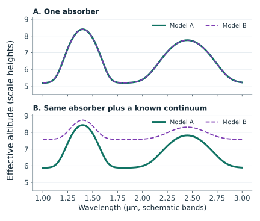

# Chapter 4 - Transmission Spectroscopy

## 4.1 What does a transit spectrum measure?

A planet can cast a slightly larger shadow in one color than in another. During a transit, its opaque disk blocks part of the stellar surface. Above that disk, starlight passes through a thin ring of atmosphere around the planet's edge, or **terminator**. At a wavelength where the atmosphere is more opaque, the shadow extends to a higher altitude.

An observer begins with a time series of stellar spectra. In each wavelength bin, they fit a [transit light curve](#Chapter3), accounting for the star's limb darkening and changes in the instrument baseline. The result is a series of transit depths with uncertainties. In the simple limit of uniform stellar illumination, the depth $\delta$ and the effective transit radius $R_{\rm tr}$ are related by

$$
\delta(\lambda) = \left(\frac{R_{\rm tr}(\lambda)}{R_\star}\right)^2 ,
$$

where $R_\star$ is the stellar radius. The effective radius is the radius an opaque disk would need to block the same amount of light. Its value can change even though the planet itself stays the same size. It also comes with no direct label for the pressure at that radius.

## 4.2 The atmospheric scale height

Pressure decreases upward because each layer supports the weight of the gas above it. In an ideal-gas atmosphere with nearly constant temperature $T$, gravity $g$, and mean mass per particle $\bar m$, pressure falls by a factor of $e$ for every **scale height** $H$:

$$
H = \frac{k_{\rm B}T}{\bar m g},
\qquad
P(z)=P_0 e^{-z/H}.
$$

Here $k_{\rm B}$ is Boltzmann's constant, $z$ is altitude above a reference level, and $P_0$ is the pressure at that level. If the mean molecular mass is quoted as a number in atomic mass units, multiply that number by the atomic mass unit to get $\bar m$. At fixed temperature, a hydrogen-rich atmosphere extends farther than one dominated by heavier molecules. Stronger gravity compresses either atmosphere.

A radius change of one scale height adds approximately $2\pi R_p H$ to the shadow, where $R_p$ is a representative planet radius. Dividing by the stellar disk area gives the change in depth per scale height:

$$
\Delta\delta_{1H}\simeq \frac{2R_pH}{R_\star^2},
\qquad H\ll R_p.
$$

**Worked example.** Take a hot giant with $T=1{,}200$ K, $\bar m=2.3$ atomic mass units, $g=10$ m s$^{-2}$, and $R_p=72{,}000$ km, orbiting a star with $R_\star=696{,}000$ km. The scale height is about **434 km**. One scale height changes the transit depth by about **129 parts per million (ppm)**. A band that raises the effective radius by three scale heights changes the depth by about **390 ppm**. Three scale heights is an illustrative band contrast. The actual contrast depends on the opacity of the band and the nearby continuum.

A small star increases the signal for the same planet, but target selection also depends on stellar brightness, activity, the observing band, and the instrument. A sample chosen for strong transmission signals will favor some atmospheres over others.

## 4.3 Why the slant path matters

Picture a light ray skimming the planet. Near its closest approach, it spends a long distance in gas at almost the same altitude. That slant path can have substantial optical depth even where a vertical path through the atmosphere would be nearly transparent.

The atmosphere also has a gradual edge. Some rays are almost entirely absorbed or scattered out of the beam, while others are only partly attenuated. The effective radius accounts for the cumulative effect of those rays across the whole annulus. A strong molecular band raises that radius because the same attenuation occurs higher up.

### From chord optical depth to occulting area

Let $b$ be the chord impact parameter measured from the planet center, $s$ the distance along the ray, $\rho$ the gas mass density, and $\kappa_\lambda$ the mass extinction coefficient. For direct-beam attenuation, the fractional intensity removed on the chord is $1-e^{-\tau_\lambda(b)}$, where

$$
\tau_\lambda(b)=\int_{-\infty}^{\infty}\kappa_\lambda(s)\rho(s)\,ds .
$$

For an opaque lower boundary at $R_0$, adding the attenuated area of each annulus gives

$$
R_{\rm tr}^2(\lambda)=R_0^2+
2\int_{R_0}^{\infty}\left[1-e^{-\tau_\lambda(b)}\right]b\,db .
$$

To see the slant enhancement, approximate the height above the tangent point as $s^2/(2b)$. The exponential density profile then becomes Gaussian along the chord. For $H\ll R_0$, $b\simeq R_0$ in the geometric prefactor, and for an opacity approximately constant along the chord,

$$
\tau_\lambda(b)\simeq \tau_{0,\lambda}\,e^{-(b-R_0)/H},
\qquad
\tau_{0,\lambda}=\frac{\kappa_\lambda P_0}{g}
\sqrt{\frac{2\pi R_0}{H}} .
$$

The factor $\kappa_\lambda P_0/g$ is the vertical optical depth above the reference level under these assumptions. The square-root term is the slant enhancement. For the worked example, it is about 32.

## 4.4 What sets the height of an absorption band?

With an isothermal limb, nearly constant gravity and composition, and opacity that is effectively independent of pressure, the change in transit radius between two wavelengths with opacities $\kappa_1$ and $\kappa_2$ is approximately

$$
R_{\rm tr}(\lambda_2)-R_{\rm tr}(\lambda_1)
\simeq H\ln\!\left(\frac{\kappa_2}{\kappa_1}\right).
$$

An opacity ratio of ten raises the effective radius by about $2.3H$. For the hot giant above, this corresponds to about **300 ppm**. The logarithm explains why a line with 100 times the opacity moves the effective radius by about twice as far as one with ten times the opacity. It also shows why measuring a band height constrains $H$ only when the opacity contrast is understood. [Heng & Kitzmann (2017)](https://doi.org/10.1093/mnras/stx1453)

### The effective chord optical depth

In the thin-atmosphere limit with a deep reference layer, $\tau_{0,\lambda}\gg1$, the area integral yields

$$
R_{\rm tr}(\lambda)\simeq R_0+H\big[\gamma+\ln\tau_{0,\lambda}\big],
$$

where $\gamma\simeq0.5772$ is the Euler–Mascheroni constant. Evaluating the chord optical depth at this effective radius gives $e^{-\gamma}\simeq0.56$. This number comes from matching the integrated partially transparent annulus to an opaque disk. If the reference layer is an opaque boundary with finite overlying optical depth, the corresponding approximation retains the term $H E_1(\tau_{0,\lambda})$, where $E_1(x)=\int_x^\infty e^{-t}\,dt/t$. A cloud boundary or pressure-dependent extinction can invalidate the deep-layer relation. [de Wit & Seager (2013)](https://doi.org/10.1126/science.1245450) · [Heng & Kitzmann (2017), equations 9–12 and 24](https://arxiv.org/pdf/1702.02051)

## 4.5 Can a spectrum weigh a planet?

Julien de Wit and Sara Seager proposed **MassSpec**. Gravity changes how rapidly the atmosphere thins with altitude, so the spectrum can carry information about the planet's mass. With a known radius, and with temperature and mean particle mass constrained by the spectrum or other information, a measurement of $H$ can be translated into mass:

$$
M_p \simeq \frac{g R_p^2}{G}
       = \frac{k_{\rm B}T R_p^2}{G\bar m H},
$$

where $G$ is the gravitational constant. For example, if Rayleigh scattering from a known gas dominates the extinction over some wavelength interval, $\kappa_\lambda\propto\lambda^{-4}$ and $dR_{\rm tr}/d\ln\lambda\simeq-4H$. With the scale height in hand, the assumed temperature and mean particle mass determine the inferred gravity. De Wit and Seager applied this reasoning to HD 189733 b and obtained a mass consistent with its [radial-velocity](#Chapter5) measurement. [de Wit & Seager (2013)](https://doi.org/10.1126/science.1245450)

**Try it.** If the example planet's radius, temperature, and composition stay fixed but its gravity doubles, what happens to its spectral band heights in the simple model? Its scale height halves, so the tenfold opacity contrast falls from about 300 to 150 ppm. Doubling the mean particle mass at the original gravity gives the same change. A slope or feature height alone cannot tell these cases apart.

In practice, aerosols may give the slope a different wavelength dependence, and clouds can suppress the contrast used to estimate $H$. Simulated retrievals have found that gravity can be hard to separate from composition and cloud altitude, especially for smaller planets. An independent mass from Doppler measurements or transit timing can make the atmospheric inference much more informative. A later study by de Wit, Seager, and Prajwal Niraula explores when the opposite workflow can be useful: determining mass and atmospheric properties together for favorable targets with informative JWST spectra. Conditions and assumptions matter more than whether the analysis starts with a mass measurement. [Batalha, Kempton & Mbarek (2017)](https://arxiv.org/abs/1701.00012) · [de Wit, Seager & Niraula (2025 preprint)](https://arxiv.org/abs/2509.25323)

## 4.6 The radius–pressure–abundance degeneracy

Kevin Heng and Daniel Kitzmann asked a different question: even if the scale height were known, what pressure corresponds to the measured transit radius? Measuring a broadband radius fixes the planet's apparent size in that band. A pressure assigned to that radius is a model assumption unless the data provide a pressure anchor.

Consider a simplified spectrum in which one well-mixed gas dominates all the observed extinction. At fixed $R_0$, gravity, and scale height, let its contribution to the opacity be proportional to its mixing ratio $X$. The optical depth then scales with $P_0 X$. Raising the reference pressure tenfold and lowering the gas mixing ratio tenfold gives the same optical depth at every wavelength in this idealization. The spectrum can still show the gas's distinctive shape, while leaving its absolute abundance ambiguous. Allowing the reference radius to vary introduces another way to change the spectrum's baseline. Heng and Kitzmann demonstrated this normalization problem in the context of interpreting narrow-band Hubble spectra. [Heng & Kitzmann (2017)](https://doi.org/10.1093/mnras/stx1453)

<figure class="orbit-figure">
  
  <figcaption>Synthetic example using the isothermal, deep-reference approximation. Model B uses ten times the reference pressure and one-tenth the absorbing gas fraction of Model A. The curves coincide when only that gas contributes opacity. Adding the same fixed continuum opacity per unit gas mass to both models changes the contrast and can help distinguish them. The bands are schematic and represent no specific molecule. Original figure based on Heng &amp; Kitzmann (2017).</figcaption>
</figure>

### Recovering a pressure anchor

If $\kappa_\lambda=X\,\kappa_{\rm gas}(\lambda)$, then the spectrum is invariant under $P_0\to fP_0$ and $X\to X/f$ in the one-absorber model at fixed geometry and mean particle mass. The latter assumption is appropriate for a trace absorber in this example. If an independently constrained opacity $\kappa_{\rm bg}$ contributes, $P_0\kappa_\lambda=P_0[X\kappa_{\rm gas}(\lambda)+\kappa_{\rm bg}(\lambda)]$ changes under that transformation.

In real spectra, collision-induced absorption depends on the density of collision partners, and pressure-broadened line wings also respond to pressure. Such features can help anchor the model when the relevant wavelength ranges are observed, the signals are strong enough, and the underlying physics and composition are constrained. Broader coverage can also constrain overlapping absorbers and clouds. The gain in information depends on the planet, the data, and the model. [Fisher & Heng (2018)](https://doi.org/10.1093/mnras/sty2550) · [Information content of JWST spectra of WASP-39b (2024)](https://doi.org/10.1051/0004-6361/202348802)

## 4.7 Retrieval and the limits of interpretation

A **forward model** predicts the measured depths for a chosen atmosphere and observing setup. A **retrieval** compares many such predictions with the measured spectrum to infer a range of plausible atmospheric properties. Those ranges depend on both the data and the assumptions used to generate the predictions.

| What you see | What to check before interpreting it |
| --- | --- |
| A repeating pattern of peaks | Do their positions and relative strengths match the proposed absorber after binning to the instrument's resolution? Could other gases or the star account for them? |
| A weak or flat spectrum | Can a high cloud deck, a small scale height, weak gas opacity, or the measurement noise explain the data? Which models does the observation actually rule out? |
| A slope toward shorter wavelengths | Could aerosol scattering or a mismatch between the stellar transit chord and the disk-integrated stellar spectrum account for the slope? |
| A precise abundance estimate | Does it survive different pressure, cloud, composition, and gravity assumptions? Which part of the spectrum constrains it? |

The terminator can include morning and evening regions with different temperatures or clouds. Their contributions combine in the measured shadow. A one-dimensional model should be interpreted as a simplified description of that combined signal. The illuminating star matters too: unocculted spots or bright regions alter the disk-integrated spectrum relative to the part the planet crosses. This **transit light source effect** can introduce apparent planetary features. [Rackham, Apai & Giampapa (2018)](https://arxiv.org/abs/1711.05691)

### How to check a retrieval

Bin the model in the same wavelength channels as the observations. Inspect the residuals and account for any important correlations between bins or offsets between observing modes. Compare candidate atmospheres with and without the proposed absorber, and refit with plausible alternatives for clouds and stellar heterogeneity. Report posterior correlations and check which results change when an independent mass is included or omitted. For a nondetection, say which models would have produced a detectable signal at the available precision.

## 4.8 An observed example: carbon dioxide on WASP-39 b

JWST transit time series of the gas giant WASP-39 b yielded a prominent absorption band near **4.3 micrometres**. Its wavelength and shape matched carbon dioxide opacity in atmospheric models. The study compared independent reductions and model calculations, linking the feature to a recognizable molecule. Turning the detection into a mixing ratio or a constraint on bulk metallicity adds assumptions about other absorbers, temperature, clouds, and the pressure scale. A subsequent analysis of JWST spectra used the richer opacity information to examine how well those model parameters can be disentangled. [JWST Transiting Exoplanet Community Early Release Science Team (2023)](https://pmc.ncbi.nlm.nih.gov/articles/PMC9946830/) · [Information content of JWST spectra of WASP-39b (2024)](https://doi.org/10.1051/0004-6361/202348802)

When reading a new transmission-spectrum paper, ask three questions. What feature is directly measured? Which inference follows from the shape of that feature? Which inference depends on a model choice or an independent measurement? The same questions apply to much subtler claims about [biosignatures](#Chapter6).
