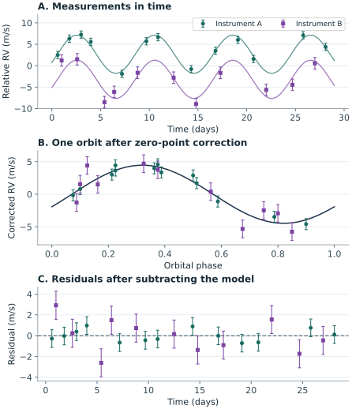

# Chapter 5 - The Radial Velocity Method

## 5.1 The planet you cannot see

In 1995, Michel Mayor and Didier Queloz reported that the velocity of the Sun-like star 51 Pegasi repeated on a roughly 4.23-day cycle. The interpretation was a giant planet on a tight orbit, well inside the distance from Mercury to the Sun. They measured the motion of the star. The planet was inferred from the regularity, amplitude, and character of that motion. [Mayor & Queloz (1995)](https://doi.org/10.1038/378355a0)

The star and planet both orbit their common center of mass, or **barycenter**. The star moves less because it is more massive. If part of its motion is along our line of sight, its spectral lines move toward longer wavelengths as the star recedes and shorter wavelengths as it approaches. This component of motion is the **radial velocity**, or RV.

For a small speed compared with the speed of light,

$$
\frac{\Delta\lambda}{\lambda}\simeq\frac{v_r}{c},
$$

where $\lambda$ is the reference wavelength, $v_r$ is positive for recession, and $c$ is the speed of light. At a reference wavelength of 600 nanometres, a velocity of 1 metre per second corresponds to a shift of about 0.000002 nanometres. Astronomers estimate tiny shifts by combining information from many wavelengths and repeated observations.

## 5.2 From a spectrum to a velocity

A precise RV measurement begins with a calibrated spectrum. The instrument maps detector positions to wavelengths, using a reference such as a laser frequency comb or, in some spectrographs, an iodine absorption cell. A pipeline compares the stellar spectrum with a template or a mask of known lines, taking account of instrument response. It corrects for the observatory's motion relative to the Solar System barycenter and masks or models absorption from Earth's atmosphere.

The result is a time series of observing times, velocities, and uncertainties. Measurements from different spectrographs often have different velocity zero points. Even a change to one instrument can create a new zero point. A shift measured from many lines can be real stellar motion, an instrumental effect, or a change in the shape of the lines themselves. Calibration and the planet fit address different parts of that problem. [Fischer et al. (2016)](https://doi.org/10.1088/1538-3873/128/964/066001)

## 5.3 Reading the orbit in the curve

A single planet on a circular orbit produces a sinusoidal stellar RV signal. Its **period** $P$ is the time between repeats. Its **semi-amplitude** $K$ is half the separation between the model's maximum and minimum velocity. Its phase tells us where the star was in the cycle at a reference time. Period and phase can be known in advance for a transiting planet, though the relation between transit time and the RV curve depends on orbital shape and orientation.

An eccentric orbit can give a rapid swing near periastron and a slower change elsewhere. The shape depends on both eccentricity and the angle from which we view the orbit. For a nearly circular orbit, the direction of periastron is poorly determined.

<figure class="orbit-figure">
  
  <figcaption>Simulated observations of an eight-day planet with two instruments. The fit holds the period fixed. The top panel retains each instrument's fitted zero point. The middle panel removes those offsets and folds every observation onto the same orbital cycle. The bottom panel shows what remains after subtracting the full model. Error bars show one-standard-deviation measurement uncertainties. The layout follows the diagnostics in RadVel.</figcaption>
</figure>

A **phase-folded** plot tests whether data from different cycles line up. The **residuals**, or measured velocity minus predicted velocity, show whether the fit leaves structure behind. Read both alongside the original time series. A phase plot hides gaps between observing seasons and can obscure long-term drifts. [Fulton, Petigura, Blunt & Sinukoff (2018)](https://doi.org/10.1088/1538-3873/aaaaa8) · [RadVel plotting source](https://github.com/California-Planet-Search/radvel/blob/master/radvel/plot/orbit_plots.py)

### The Keplerian model

For one companion, the stellar velocity in instrument $j$ can be written

$$
v_j(t)=\gamma_j+K[\cos(\nu(t)+\omega)+e\cos\omega],
$$

where $\gamma_j$ is the instrument's velocity offset, $e$ is orbital eccentricity, $\nu(t)$ is the true anomaly, and $\omega$ is the argument of periastron of the **star's** reflex orbit in this convention. Time enters through [Kepler's equation](#Chapter2). For $e=0$, the velocity becomes a sinusoid and only the combined orbital phase is meaningful.

Fit the velocities in the time domain. If multiple companions are well separated dynamically, sum their Keplerian signals and include one offset per instrument. Where mutual perturbations are measurable, fit a dynamical model that integrates the bodies' motion. A slow trend over a short observing baseline can suggest an outer companion, but the trend alone often leaves its period and mass poorly constrained.

## 5.4 Turning a semi-amplitude into a mass

With orbital eccentricity $e$, stellar mass $M_\star$, companion mass $M_p$, orbital inclination $i$, and gravitational constant $G$, the semi-amplitude is

$$
K=\left(\frac{2\pi G}{P}\right)^{1/3}
  \frac{M_p\sin i}{(M_\star+M_p)^{2/3}}
  \frac{1}{\sqrt{1-e^2}} .
$$

An edge-on orbit has $i=90^\circ$ and the largest projected velocity for a given mass. For a planet much lighter than its star, the RV curve and a stellar mass estimate give $M_p\sin i$, conventionally called the **minimum mass**. A more massive planet on a more face-on orbit can have the same signal. A transit usually constrains $i$ near $90^\circ$, and astrometry can constrain the inclination of some non-transiting systems.

**Worked example.** A circular 10-day orbit around a one-solar-mass star gives a measured $K=3.0$ m s$^{-1}$. In the low-companion-mass approximation, one Earth mass in that orbit would produce about 0.297 m s$^{-1}$ if viewed edge-on. The measured minimum mass is therefore about **10.1 Earth masses**. If $i=30^\circ$, the true mass is about **20.2 Earth masses**. If the same planet instead transits and its radius is $2.5$ Earth radii, the nearly edge-on solution gives a bulk density of about **3.6 g cm$^{-3}$**. Density narrows the range of interior models, but different compositions and structures can share a bulk density.

The same equation gives about **28.4 m s$^{-1}$** for a Jupiter-mass planet in a circular edge-on orbit at 1 AU around a Sun-like star. Jupiter at its actual orbital distance of about 5.2 AU produces about **12.5 m s$^{-1}$** in that geometry. An Earth analog produces about **0.089 m s$^{-1}$**. These are semi-amplitudes. Detectability also depends on the observing baseline, cadence, and correlated noise.

## 5.5 When you observe changes what you can find

If the orbit is already known and circular, a measurement near either velocity extremum carries more information about the amplitude than a measurement near the crossing of the systemic velocity. Measurements around the full orbit help check timing, eccentricity, other planets, and the assumed stellar model.

Jennifer Burt, Bradford Holden, Angie Wolfgang, and L. G. Bouma simulated several ways to schedule follow-up of small TESS planets with the Automated Planet Finder. In their simulations, targeting more uniform orbital phase coverage recovered more significant masses than targeting quadrature alone. They also found that keeping only high-significance masses biased their recovered small-planet mass–radius relation upward. When a weak measurement fluctuates high, it is more likely to pass a significance cut than one that fluctuates low. Including low-significance measurements and upper-limit information helped mitigate the bias in their simulated population. [Burt et al. (2018)](https://doi.org/10.3847/1538-3881/aae697)

A separate sampling problem is **aliasing**. Observing once per night or only during certain seasons can turn one true periodicity into several plausible peaks in a periodogram. A periodogram summarizes how strongly the sampled data favor different trial frequencies. The **spectral window** shows which frequencies the observing times themselves imprint. To test an alias, simulate each candidate signal at the actual observation times and compare the resulting pattern of peaks. New observations at times when the candidate predictions differ can break the tie. Dawson and Fabrycky used this approach to revise the inferred period of 55 Cancri e to about 0.74 days. [Dawson & Fabrycky (2010)](https://doi.org/10.1088/0004-637x/722/1/937)

### A sampling exercise

Suppose you observe at exactly the same time every night. An orbit with frequency 0.2 cycles per day advances by 0.2 cycles between visits. An orbit with frequency 1.2 cycles per day advances by 1.2 cycles, which is the same phase advance after discarding the complete turn. The two can yield identical samples of a sinusoid on that artificial schedule. A visit displaced by half a day shifts their relative phase by half a cycle. Real observing times are irregular, so use the actual timestamps when comparing aliases.

## 5.6 When the star imitates a planet

A rotating star presents an approaching hemisphere and a receding hemisphere. A dark spot suppresses light from one part of that velocity field. As the spot rotates across the disk, the estimated velocity changes even if the star's center of mass is steady. Magnetic regions also change how much convective motion shifts the lines. Pulsations and granulation contribute on other timescales.

Look for related changes in line shape, starspot modulation in photometry, and activity indicators such as the calcium H and K lines. Compare wavelength ranges and instruments when the data permit. A candidate that remains coherent across seasons and is consistent with an independently measured transit period warrants more confidence. Similarity to the rotation period, or to a harmonic, is a reason to test competing explanations. A weak correlation with an activity indicator by itself gives little assurance that the star is quiet. [Rajpaul et al. (2015)](https://doi.org/10.1093/mnras/stv1428)

### What the cross-correlation function tells us

A **cross-correlation function (CCF)** compares the observed spectrum with a mask of stellar absorption lines at a series of trial velocities. For instruments such as HARPS-N, the resulting dip resembles an average absorption line. Fitting its center gives an RV estimate. A planet's reflex motion primarily shifts the whole dip along the velocity axis. A spot or a change in convection can deform the dip and move its fitted center at the same time. The CCF width and the asymmetry of its two sides are useful activity indicators. Comparing the full shape across exposures can reveal changes those two numbers miss. [de Beurs et al. (2024)](https://doi.org/10.1093/mnras/stae207)

Zoë de Beurs and colleagues used this distinction to weigh **K2-167 b**, a transiting sub-Neptune whose mass had been difficult to measure because of excess RV scatter. Their **CCF Activity Linear Model (CALM)** uses changes in the shape of aligned CCFs to estimate the activity contribution while fitting the planetary orbit. Combining the updated HARPS-N velocities with transit data, they inferred a mass of **6.3 ± 1.4 Earth masses**. Figure 3 of their paper traces the process from a changing line profile to an activity correction. [de Beurs et al. (2024), paper and figures](https://arxiv.org/abs/2401.12276)

The same line-shape effect is useful when its cause is known. During a transit across a rotating star, a planet blocks light from successive parts of the stellar surface. This causes the **Rossiter–McLaughlin effect**, a velocity anomaly that can constrain the angle between the orbit and stellar spin as projected onto the sky. The inference needs a model of the rotating stellar disk as well as the transit geometry. [Ohta, Taruya & Suto (2005)](https://doi.org/10.1086/428344)

### Correlated noise and predictive checks

An RV likelihood can combine per-epoch measurement variance $\sigma_n^2$, additional instrument-specific white-noise variance $s_j^2$, and a covariance $C_{\rm act}(t_n,t_m)$ from stellar activity. With $\mathbf r$ the residual vector, the Gaussian log likelihood is

$$
\ln \mathcal L=-\tfrac12\left[
\mathbf r^\mathsf{T} C^{-1}\mathbf r+
\ln \det C+N\ln(2\pi)\right],
$$

where the diagonal of $C$ includes $\sigma_n^2+s_j^2$ and $N$ is the number of velocities. A Gaussian process can describe correlated stellar variability with a quasi-periodic covariance that captures recurring but evolving active regions. Photometry and spectroscopy can help constrain the recurrence and evolution timescales. Compare plausible covariance choices and check how the inferred $K$ changes with the activity priors. [Rajpaul et al. (2015)](https://doi.org/10.1093/mnras/stv1428) · [Sarah Blunt's RadVel tutorial](https://radvel.readthedocs.io/en/latest/tutorials/GaussianProcess-tutorial.html)

Sarah Blunt and collaborators tested this distinction on the young, active star V1298 Tau. They obtained additional Keck/HIRES velocities and used cross-validation to test whether a previously favored model predicted data it had not seen. They found evidence of overfitting that called the earlier RV mass estimates into question. Use holdouts that reflect the scientific prediction, such as a withheld block or new observing run, and compare the predicted values with their uncertainty. A flexible activity model can absorb part of a planet signal or leave structure that looks planetary. Check whether injected signals can be recovered through the same analysis. [Blunt et al. (2023)](https://doi.org/10.3847/1538-3881/acde78)

### Using line shape rather than time alone

CALM aligns each CCF by its fitted center, then represents departures from a reference profile at selected velocity bins. It uses those departures as predictors of the spurious RV contribution in a joint fit with the Keplerian model. A time-based Gaussian process uses the relationship between measurement times to describe correlated noise. A CCF-based model asks whether the spectrum recorded at each visit shows the deformation associated with that noise. Because alignment, interpolation, and feature selection can let some information about a real shift leak into the shape predictors, test the entire pipeline by injecting a shift upstream of those steps and checking that its amplitude is recovered. [de Beurs et al. (2024)](https://doi.org/10.1093/mnras/stae207)

De Beurs and colleagues also trained neural networks on HARPS-N solar CCFs. In a 2026 follow-up, Naomi McWilliam, de Beurs, and collaborators tested whether adding solar magnetic flux and the rate of change of total solar irradiance helped. On held-out solar data, the reported RV scatter went from **147.1 cm/s** before correction to **95.5 cm/s** with CCFs alone and **93.3 cm/s** with the added inputs. The comparison isolates the modest gain from those extra solar measurements. The authors identified instrumental shifts and supergranulation as likely contributors to the remaining scatter. Comparable magnetic and irradiance measurements may be unavailable for other stars, and reduced scatter alone does not establish sensitivity to a planet with a particular period and amplitude. [de Beurs et al. (2022)](https://doi.org/10.3847/1538-3881/ac738e) · [Research code](https://github.com/zdebeurs/exoplanet-ml) · [McWilliam et al. (2026)](https://doi.org/10.3847/1538-3881/ae45fd)

## 5.7 An observed example: weighing TOI-1231 b

Jennifer Burt and collaborators combined transit photometry with velocities from the Planet Finder Spectrograph on the Magellan Clay telescope. The transit data established a period of about **24.246 days** and a radius of approximately **3.65 Earth radii**. The Doppler follow-up constrained the mass to **15.5 ± 3.3 Earth masses**. The joint result gives a central bulk-density estimate of roughly **1.8 g cm$^{-3}$**, consistent with a planet with a substantial low-density envelope. The measured mass and radius still admit a range of possible internal structures. [Burt et al. (2021)](https://doi.org/10.3847/1538-3881/ac0432)

The roles of the two measurements are worth keeping straight. Transit timing tells you where to look for the effect of the planet. RV measures how strongly it pulls on the star. Together they constrain the planet's density and gravity. That gravity enters the scale-height calculation in [Transmission Spectroscopy](#Chapter4), where it helps distinguish the effect of atmospheric composition from the effect of compression.

## 5.8 How to read an RV detection paper

1. **Inspect the observations.** Which instruments contributed? What is the time baseline, and how much of the inferred orbit was actually sampled?
2. **Compare periods.** Does the proposed orbit have plausible daily or annual aliases? Do observations taken at new phases distinguish them?
3. **Check the stellar model.** Does the period coincide with stellar rotation or a harmonic? Do the residuals or held-out observations expose a model weakness?
4. **Read the mass with its assumptions.** Is it a minimum mass, a mass with inclination measured, or an upper limit? How much does it change with other plausible eccentricities, activity models, and priors?
5. **Ask what would have gone undetected.** Population claims require an account of sensitivity to weaker and longer-period signals, including targets with inconclusive measurements.
