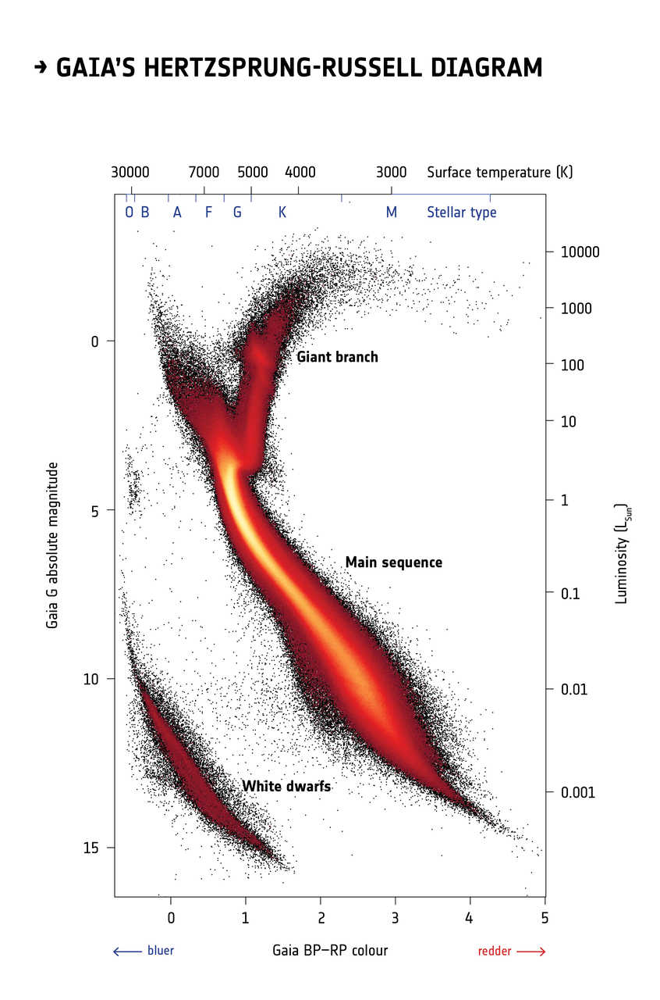
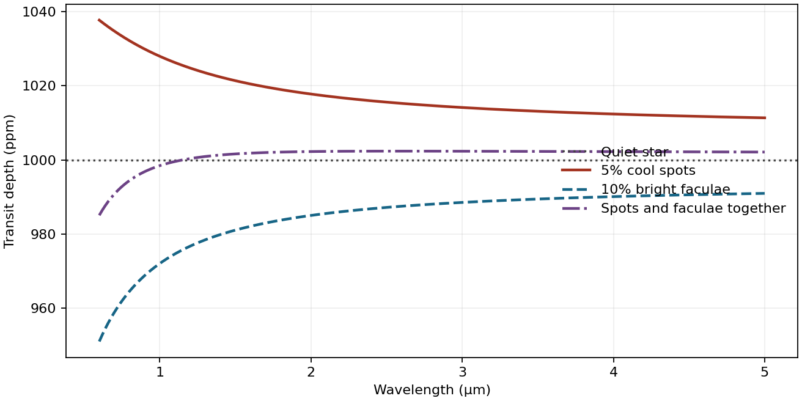

# Chapter 7 - Stars

## 7.1 Why are stars important

<div data-level="101">

When we observe a transiting exoplanet, we measure how much light from the star is blocked by the planet at different wavelengths. This measurement allows astronomers to infer the composition of the planet’s atmosphere through **transmission spectroscopy**.

However, stars are not perfectly uniform. Their surfaces often contain **starspots**, **faculae**, and other magnetic structures. These features have temperatures that differ from the surrounding stellar photosphere. Because of this, the spectrum of the star that we observe is actually a mixture of different surface components.

If the planet transits a region of the star that is different from the average stellar surface, the measured transit depth can be biased. This effect is known as **stellar contamination**.

Section 7.3 explains how this mismatch can imprint a stellar signal on a planet's transmission spectrum.

</div>

---

## 7.2 The Hertzsprung–Russell Diagram


<figure style="float: right; width: 35%; margin: 0 0 1rem 1.5rem;">
  
  <figcaption style="font-size: 0.85rem; color: #555; margin-top: 0.4rem;">
    Hertzsprung–Russell diagram of stars observed by Gaia, showing stellar luminosity as a function of color (temperature proxy). The prominent main sequence, giant branch, and white dwarf sequence trace the fundamental stages of stellar structure and evolution. [Credit: ESA/Gaia/DPAC]
  </figcaption>
</figure>


The **Hertzsprung–Russell (HR) diagram** is the single most powerful tool in stellar astronomy. It plots stellar **luminosity** (intrinsic brightness, in solar units L☉) on the vertical axis against **surface temperature** on the horizontal axis — with temperature running *rightward-to-cooler*, following the historical convention from spectral classification.

### Reading the diagram

Two physical properties determine where a star sits:

- **Luminosity** scales as the fourth power of radius and the fourth power of temperature: $L \propto R^2 T^4$ (from the Stefan–Boltzmann law). A star can be luminous because it is hot, large, or both.
- **Surface temperature** sets the star's color and determines which absorption lines dominate its spectrum — the basis for the **OBAFGKM** spectral sequence (O hottest, M coolest).

### The main sequence

Roughly 90% of all stars, including the Sun, fall along a diagonal band called the **main sequence** (also the *zero-age main sequence*, ZAMS). This is not a coincidence of arrangement — it reflects a fundamental physics: main-sequence stars are in **hydrostatic equilibrium**, balancing gravitational collapse with the outward pressure of hydrogen fusion in their cores.

Position along the main sequence is set almost entirely by **mass**:

| Region | Spectral type | Mass (M☉) | Luminosity (L☉) | Lifetime |
|--------|---------------|-----------|-----------------|----------|
| Upper left | O, B | 10–100 | 10³–10⁶ | ~10 Myr |
| Middle | A, F | 1.5–3 | 5–60 | ~1 Gyr |
| Middle | G (Sun) | 1 | 1 | ~10 Gyr |
| Lower right | K, M | 0.1–0.8 | 10⁻³–0.4 | ~100 Gyr |

The steep **mass–luminosity relation** ($L \propto M^{3.5}$ approximately) means that a star ten times the Sun's mass burns roughly 3,000 times brighter — and exhausts its fuel in a fraction of the time.

### Evolved populations

Once a star's core hydrogen is exhausted, it leaves the main sequence. The HR diagram preserves the fossil record of this evolution:

**Red giants and supergiants** (upper right). As the hydrogen shell ignites and the outer layers expand, the star becomes cooler at the surface but enormously larger — luminosity rises while temperature drops, shifting the star rightward and upward. Betelgeuse (~100,000 L☉, ~700 R☉) is the archetype.

**White dwarfs** (lower left). The endpoint of low- and intermediate-mass stellar evolution: a degenerate carbon–oxygen core no longer generating energy, slowly cooling over billions of years. Despite temperatures sometimes exceeding 25,000 K, their tiny radii (roughly Earth-sized) make them intrinsically faint.

### The HR diagram as a stellar clock

A star cluster's **main-sequence turnoff point** — the luminosity at which stars begin peeling off the main sequence toward the giant branch — directly encodes the cluster's age. More luminous (massive) stars evolve faster; measuring where the turnoff occurs yields the age without needing to know the cluster's distance. This technique underpins much of what we know about stellar populations and galactic history.

> **Connection to stellar contamination.** Stars at different points on the HR diagram have radically different surface structures. Hot O/B stars have few starspots but strong magnetic fields and rapid rotation. Sun-like G stars show well-defined spot cycles. Cool M dwarfs are heavily spotted and magnetically active. Understanding *where* a host star sits on the HR diagram — its temperature, luminosity, and spectral class — is therefore the first step in modeling the **transit light source effect** discussed in §7.3.

---

## 7.3 The Transit Light Source Effect

A transit spectrum compares the light lost during transit with the light from the whole visible stellar disk. The planet and its atmosphere sample a much smaller region, the **transit chord**. If the spectrum of that region differs from the disk average, the measured transit depth changes with wavelength for reasons that originate on the star. Benjamin Rackham, Dániel Apai, and Mark Giampapa named this mismatch the **transit light source effect**. [Rackham, Apai &amp; Giampapa (2018), *The Astrophysical Journal* 853, 122](https://doi.org/10.3847/1538-4357/aaa08c)

<figure class="orbit-figure">
  
  <figcaption><strong>The transit chord samples only part of the stellar disk.</strong> Rackham et al. (2018), Figure 1, as hosted by Benjamin V. Rackham. <a href="https://brackham.github.io/#research">Author’s figure and explanation</a> · <a href="https://arxiv.org/pdf/1711.05691v3#page=3">Figure 1 in the paper</a></figcaption>
</figure>

Suppose a planet crosses a quiet strip while cool spots lie elsewhere on the star. The spots dim the out-of-transit baseline. The planet still blocks the same bright strip, so the fraction of light lost appears larger. Because the contrast between the spots and the quiet surface changes with wavelength, the bias can appear as a slope or a molecular band. Unocculted bright faculae can have the opposite effect when they increase the baseline. A spot crossed by the planet may leave a bump in the light curve. Spots outside the path can bias the spectrum even when the light curve shows no such bump. [Rackham et al. (2018)](https://doi.org/10.3847/1538-4357/aaa08c)

### Programming demonstration — A flat planet spectrum around an active star

Start with an atmosphere-free planet whose transit depth is 1,000 ppm on a quiet star. The planet always crosses the same quiet chord. Change the surface outside the chord and see how the inferred depth changes. Cool spots deepen the transit, bright faculae make it shallower, and their different colors make the size of the bias depend on wavelength.



*The curves use synthetic blackbody spectra to illustrate the continuum bias. Stellar atmosphere spectra are needed to model features such as water bands. The disk normalization follows Rackham, Apai & Giampapa (2018). [Paper](https://doi.org/10.3847/1538-4357/aaa08c)*

[Download the Python script](/books/Exoplanets/chapters/assets/labs/transit-light-source.py)

<div data-level="201">

Use Python with NumPy and Matplotlib. From the folder where you saved the script, run:

```sh
python3 -m pip install numpy matplotlib
python3 transit-light-source.py
```

The script writes `transit-light-source.png`. It was tested with Python 3.9.5, NumPy 1.26.2, and Matplotlib 3.9.4.

For each wavelength in micrometers, the script divides the spot and facular blackbody intensities by the intensity of the quiet photosphere. It weights the three components by their projected disk fractions. The numerator stays at 1,000 ppm because the chord remains quiet.

```python
disk_contrast = (
    (1 - spot_fraction - facula_fraction)
    + spot_fraction * spot_contrast
    + facula_fraction * facula_contrast
)
depth_ppm = 1000 / disk_contrast
```

Set both covering fractions to zero to recover a flat 1,000 ppm spectrum. With only 5% spot coverage and a spot intensity half that of the quiet surface, the check gives 1,025.64 ppm. If the spot and facular contributions cancel at one wavelength, why might the bias persist elsewhere? Their contrasts vary differently with wavelength.

</div>

<div data-level="301">

### From stellar contrast to a contaminated transit depth

Suppose the planet crosses a quiet chord, and a fraction $f$ of the projected stellar disk is covered by unocculted spots. In a simplified model that sets limb darkening aside, let $I_{\rm spot}(\lambda)$ and $I_{\rm quiet}(\lambda)$ be the spot and quiet photosphere intensities. The observed transit depth is

$$
\delta_{\rm obs}(\lambda)=
\frac{\delta_{\rm quiet}(\lambda)}
{1-f\left[1-I_{\rm spot}(\lambda)/I_{\rm quiet}(\lambda)\right]}.
$$

Here $\delta_{\rm quiet}$ is the depth the same planet would produce on an entirely quiet star. For example, if spots cover 5% of the disk and are half as bright as the quiet surface in one wavelength bin, a 1,000 ppm quiet-star transit appears about 1,026 ppm deep. At a wavelength where the spots and quiet surface have the same intensity, the bias vanishes in this model. [Rackham et al. (2018), stellar-contamination model](https://doi.org/10.3847/1538-4357/aaa08c)

An observational example comes from **GJ 486 b**. Moran and colleagues showed that their JWST transmission spectrum could be fit either by a water-rich planetary atmosphere or by a stellar model with cool unocculted spots. The two fits illustrate why identifying water opacity in a transit spectrum leaves open where that water is located. [Moran et al. (2023)](https://doi.org/10.3847/2041-8213/accb9c)

Several strategies are used to mitigate stellar contamination:

- Multi-wavelength photometric monitoring of stellar variability  
- Spectroscopic diagnostics of spot temperatures  
- Forward modeling of heterogeneous stellar photospheres  
- Simultaneous stellar and planetary retrieval frameworks

Rotational monitoring helps track changes in surface brightness. A nearly steady light curve can still come from a star with substantial, roughly symmetric spot coverage. Combining monitoring with stellar spectra and repeated transits gives the stellar and planetary models more independent constraints. [Rackham et al. (2018)](https://doi.org/10.3847/1538-4357/aaa08c) · [Chapter 4: Transmission Spectroscopy](#Chapter4)

</div>
