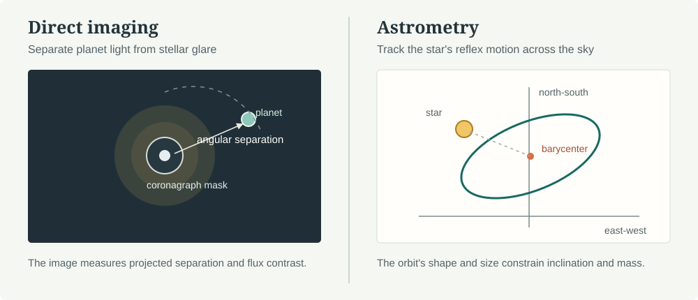

# Chapter 8 - Direct Imaging and Astrometry

A planet can be detected without crossing its star and without producing a measurable Doppler shift. Direct imaging separates the planet's light from the star's glare. Astrometry measures the star's position on the sky and searches for the small orbit it makes around the system's center of mass. Together, these methods reveal planets and orbits that are difficult to study with transits or radial velocities alone.

## 8.1 What does a direct image measure?

A telescope records light from both the star and the planet. Because the star is usually much brighter, the challenge is to suppress or model the stellar light while retaining the planet's signal. Adaptive optics corrects atmospheric blurring at ground-based observatories. A coronagraph blocks or attenuates the central starlight. Image processing can remove stable patterns in the instrument and stellar point-spread function, but it can also reduce the signal of a planet close to the star.

The two key quantities in an image are the planet's **angular separation** from the star and its **contrast**, the ratio of planet flux to stellar flux in a specified observing band:

$$
\theta\simeq\frac{s}{d},
\qquad
C(\lambda,\theta)=\frac{F_p(\lambda)}{F_\star(\lambda)}.
$$

Here $s$ is the projected star-planet separation, $d$ is distance, and $\lambda$ is wavelength. When $s$ is in astronomical units and $d$ in parsecs, $\theta$ is in arcseconds. The measured $s$ is a projection onto the sky, not the planet's full three-dimensional distance from the star.

A **contrast curve** gives an instrument's limiting detectable contrast as a function of angular separation, often at a stated statistical threshold. A planet below that curve may be present but undetectable in the observation. The smallest separation at which the instrument can reliably distinguish a planet from the star is its **inner working angle**. Neither quantity is a universal property of a telescope: wavelength, observing conditions, processing choices, and the stellar brightness all matter.

<figure class="orbit-figure">
  
  <figcaption><strong>Two complementary views of an orbit.</strong> Direct imaging measures a planet's light and projected separation; astrometry measures the star's changing sky position. Both panels are schematic and not to scale.</figcaption>
</figure>

## 8.2 Where does the planet's light come from?

At visible wavelengths, a directly imaged planet may be seen mainly in reflected starlight. A useful approximation to the planet-to-star flux ratio is

$$
\frac{F_p}{F_\star}\simeq A_g\,\Phi(\alpha)\left(\frac{R_p}{r}\right)^2,
$$

where $A_g$ is the geometric albedo, $\Phi(\alpha)$ is a phase function normalized to one at full phase, $\alpha$ is the star-planet-observer phase angle, $R_p$ is the planet radius, and $r$ is its instantaneous distance from the star. The approximation assumes reflected light dominates and treats the star as a point source at the planet. Clouds, atmospheric absorption, and viewing geometry all shape the observed spectrum.

Young giant planets can also be bright in their own thermal emission, especially at infrared wavelengths. In a simple blackbody approximation,

$$
\frac{F_p(\lambda)}{F_\star(\lambda)}\simeq
\left(\frac{R_p}{R_\star}\right)^2
\frac{B_\lambda(T_p)}{B_\lambda(T_\star)},
$$

where $B_\lambda$ is Planck spectral radiance and $T_p$ and $T_\star$ are the planet's and star's effective temperatures. Real spectra require atmospheric models. Infrared colors can constrain temperature and clouds, while a sequence of images over time can show orbital motion and help reject background stars.

Direct imaging is most favorable for planets with large projected separations and high planet-to-star contrast. Young giant planets are often still warm from formation, making their thermal emission easier to detect. Older, cooler planets and close-in planets are more difficult because they are fainter or lie closer to the stellar glare. The first directly imaged multi-planet system around HR 8799 demonstrated that wide-orbit giant planets can be detected and followed over time. [Marois et al. (2008)](https://doi.org/10.1126/science.1166585) · [Bowler (2016), review of imaging extrasolar giant planets](https://doi.org/10.1146/annurev-astro-081915-023435)

## 8.3 Worked example: angular separation

Suppose a planet has an orbital separation of 5.2 AU and its system is 10 pc away. If the planet is near the part of its orbit where the projected separation is also 5.2 AU, its angular separation is

$$
\theta\simeq\frac{5.2\ {\rm AU}}{10\ {\rm pc}}=0.52\ {\rm arcsec}.
$$

This estimate tells us where the planet would appear relative to its star on the sky. It does not show that the planet is detectable: that depends on the contrast curve at 0.52 arcsec and on the planet's brightness in the observing band. At another orbital phase, the projected separation could be smaller even though the semimajor axis is unchanged.

**Check your reasoning.** If the same system were twice as far away, what would happen to its angular separation? It would be halved, to 0.26 arcsec, while the planet's physical orbit remained the same.

## 8.4 Astrometry measures the star's reflex orbit

The planet does not orbit a stationary star. Both bodies orbit their common center of mass. Astrometry measures the star's changing position against more distant reference sources. After accounting for the star's proper motion and annual parallax, a periodic residual can reveal the star's **reflex motion** caused by an orbiting companion.

For a two-body system, the star's orbital semimajor axis about the barycenter is

$$
a_\star=\frac{M_p}{M_\star+M_p}a_{\rm rel},
$$

where $M_p$ and $M_\star$ are the planet and stellar masses and $a_{\rm rel}$ is the relative-orbit semimajor axis. Its angular size is

$$
\alpha_\star({\rm arcsec})=\frac{a_\star({\rm AU})}{d({\rm pc})}.
$$

Unlike radial velocity, astrometry measures motion in the plane of the sky. With a well-sampled orbit, the shape and orientation of the projected path constrain inclination and the longitude of the ascending node. Combining astrometry with radial velocities can resolve the inclination ambiguity in $M_p\sin i$ and yield a dynamical mass. A transit, when present, gives a strong independent constraint on inclination.

**Worked example.** A Jupiter-mass planet at 5.2 AU around a Sun-mass star makes the star move by approximately

$$
a_\star\simeq\frac{M_J}{M_\odot}(5.2\ {\rm AU})
\simeq0.0050\ {\rm AU}.
$$

At 10 pc, this corresponds to about $0.00050$ arcsec, or **0.50 milliarcseconds**. This is the angular semimajor axis of the star's reflex orbit before projection. The observed path may appear smaller or more elongated depending on orbital orientation.

## 8.5 Turning measurements into an orbit

An image gives a planet's position relative to its star at a particular epoch. A single position usually cannot determine an orbit. Repeated images add motion; astrometric measurements add the star's reflex displacement; radial velocities constrain the line-of-sight component. A joint orbital fit can combine these data while accounting for their different reference frames and uncertainties.

| Data | Directly measured | Common inference | Important limitation |
| --- | --- | --- | --- |
| High-contrast image | Planet-star angular separation and flux ratio in a band | Projected position, colors, and eventually an orbit | Projection and selection by contrast and inner working angle |
| Astrometric time series | Star position on the sky at each epoch | Reflex orbit, inclination, and companion mass | Proper motion, parallax, calibration, and incomplete orbital coverage |
| Radial velocities | Line-of-sight stellar velocity | Period, eccentricity, and projected companion mass | Activity and the $M_p\sin i$ degeneracy without inclination |
| Transit data | Relative flux during a crossing | Planet radius and near-edge-on geometry | Only a narrow range of viewing orientations transits |

An orbit is therefore a model constrained by several kinds of measurements, not a tracing of a single image. Report which data constrain each orbital element, whether the orbit is fully observed, and how the inferred parameters change across plausible fits. [Perryman et al. (2014)](https://doi.org/10.1088/0004-637X/797/1/14) · [ESA Gaia Data Release 3](https://www.cosmos.esa.int/web/gaia/data-release-3)

## 8.6 Summary

Direct imaging detects a planet's light at a projected separation from its star. Astrometry detects the star's motion around the system barycenter. Direct images are limited by contrast and angular resolution; astrometric orbits are limited by precision, cadence, and orbital coverage. Combining these measurements with radial velocities or transits can turn projected signals into stronger constraints on a planet's mass and three-dimensional orbit.