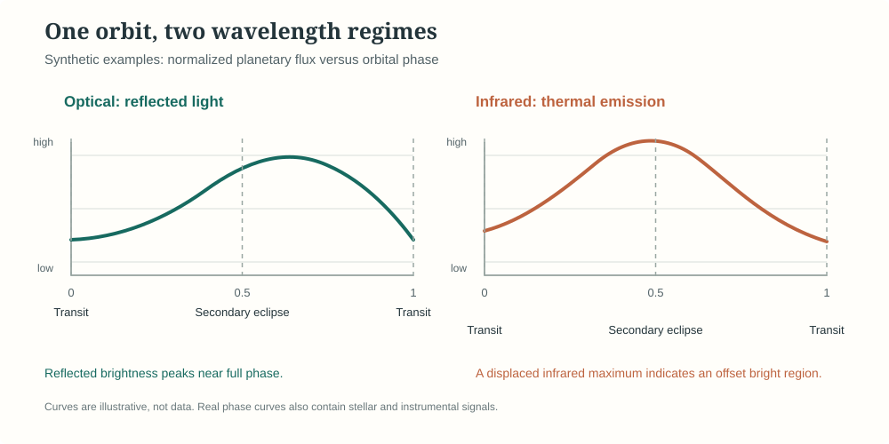

# Chapter 9 - Planetary Phase Curves

A planet's brightness can change as it moves around its star. At some orbital phases we see more of its hot dayside; at others, more of its cooler nightside. In reflected light, the visible fraction of the illuminated hemisphere changes as well. A **phase curve** records this repeating variation and turns it into evidence about a planet's atmosphere, temperature, and reflectivity.

## 9.1 What a phase curve measures

A phase curve is a time series of the combined star-planet flux, usually folded on the planet's orbital period. After modeling the star and removing instrumental trends, astronomers look for a small periodic change associated with the planet. The phase curve is often reported as the planet-to-star flux ratio,

$$
f_p(\phi)=\frac{F_p(\phi)}{F_\star},
$$

where $\phi$ is orbital phase. Here, phase zero is defined at the center of a primary transit and phase $0.5$ at the center of a secondary eclipse for a circular orbit. The planet is hidden at transit and secondary eclipse, so those events also help establish the stellar baseline and the dayside flux.

<figure class="orbit-figure">
  
  <figcaption><strong>Different wavelengths trace different parts of the energy budget.</strong> The curves are synthetic examples, not observations. Reflected light follows the visible illuminated area; thermal emission can peak before or after secondary eclipse when the hottest region is displaced from the substellar point.</figcaption>
</figure>

Optical phase curves may contain reflected starlight, thermal emission from a very hot planet, or both. Infrared curves are usually more directly sensitive to planetary thermal emission. A measured amplitude is not automatically a temperature difference or an albedo: it depends on wavelength, orbital geometry, the star, and the way the light curve is modeled.

## 9.2 Reflected light and geometric albedo

For reflected light, an approximate planet-to-star flux ratio is

$$
\frac{F_p}{F_\star}=A_g\,\Phi(\alpha)\left(\frac{R_p}{a}\right)^2,
$$

where $A_g$ is geometric albedo, $\Phi(\alpha)$ is the phase function normalized to one at full phase, $\alpha$ is the star-planet-observer angle, $R_p$ is planet radius, and $a$ is orbital separation for a circular orbit. At full phase, the illuminated hemisphere faces the observer; near secondary eclipse it is about to disappear behind the star. The albedo is wavelength-dependent and summarizes how efficiently the atmosphere and clouds reflect light back toward the observer.

**Worked example.** Consider a Jupiter-radius planet with $R_p=7.15\times10^7$ m in a circular orbit at $a=0.05$ AU, where $1$ AU is $1.496\times10^{11}$ m. Suppose its geometric albedo is $A_g=0.10$. At full phase, $\Phi=1$, so

$$
\frac{F_p}{F_\star}\simeq0.10\left(\frac{7.15\times10^7}{0.05\times1.496\times10^{11}}\right)^2
\simeq9.1\times10^{-6},
$$

or about **9 parts per million** of the stellar flux. This is an idealized reflected-light estimate. Thermal emission, nonuniform clouds, and the phase function away from full phase can change the observed curve.

**Check your reasoning.** If the planet's radius doubled while all other quantities remained fixed, how would the reflected-light ratio change? It would increase by a factor of four because the ratio is proportional to $R_p^2$.

## 9.3 Thermal emission and heat transport

A planet absorbs some fraction of the starlight that reaches it and emits energy back to space. The balance depends on the absorbed fraction, internal heat, and how effectively winds and circulation move energy from the dayside to the nightside. A large day-night contrast can indicate inefficient redistribution, but it can also depend on atmospheric opacity, rotation, clouds, and the pressure levels sampled at the observing wavelength.

At a single wavelength, the thermal planet-to-star flux ratio can be approximated by

$$
\frac{F_p(\lambda)}{F_\star(\lambda)}\simeq
\left(\frac{R_p}{R_\star}\right)^2
\frac{B_\lambda(T_p)}{B_\lambda(T_\star)},
$$

if both bodies are treated as blackbodies. The $T_p$ inferred this way is a **brightness temperature** for that band, not necessarily the planet's average surface or atmospheric temperature. Real spectra and phase curves require radiative-transfer models.

An infrared phase curve can constrain the temperature pattern as the planet rotates through view. If the brightest region is shifted east or west of the substellar longitude, the flux maximum occurs before or after secondary eclipse. Such a **phase offset** is evidence of an asymmetric brightness map. It is not a direct measurement of wind speed: the conversion depends on radiative timescales, atmospheric circulation, and the pressure level being observed. The thermal phase curve of HD 189733 b demonstrated how orbital brightness variations can map a hot Jupiter's day-night contrast. [Knutson et al. (2007)](https://doi.org/10.1038/nature06002) · [Cowan & Agol (2008)](https://doi.org/10.1086/590551)

## 9.4 Reading the shape of the curve

For a circular orbit, a simple first-harmonic model is

$$
f_p(\phi)=C+A\cos\!\left[2\pi(\phi-\phi_{\rm max})\right],
$$

where $C$ is the mean planet flux, $A$ is the amplitude of the fundamental variation, and $\phi_{\rm max}$ is the phase of maximum brightness. The model is a compact description, not a full map of the planet. A symmetric dayside pattern peaks near secondary eclipse at $\phi=0.5$. A displaced maximum implies a longitudinal offset in the brightness distribution.

| Curve feature | Possible interpretation | What else to test |
| --- | --- | --- |
| Brightness maximum near secondary eclipse | Dayside dominates the observed band | Separate thermal emission from reflected light, especially in optical data |
| Brightness maximum before or after eclipse | Offset hot region or asymmetric reflection | Check for eccentricity, time-variable weather, and stellar variability |
| Large peak-to-trough variation | Strong phase-dependent brightness | Compare wavelengths; opacity changes the atmospheric layer sampled |
| Shallow variation | Efficient redistribution, high reflectivity, or weak signal | Check precision, clouds, dilution, and correlated instrumental noise |

In optical data, additional effects can mimic or modify a planetary phase curve. Reflected light and thermal emission vary at the orbital period. Doppler beaming also has an orbital-period component, while tidal distortion of the star can create a signal at twice the orbital frequency. Stellar rotation, spots, and instrumental systematics can add other variations. Model all relevant components and use multiple wavelengths or independent observations where possible.

## 9.5 From a light curve to an atmospheric inference

The raw observation is a time series of total system brightness. Inference usually proceeds by fitting the transit, secondary eclipse, planetary phase variation, stellar variability, and instrument baseline together. A secondary-eclipse depth measures the planet's dayside flux in the observed band when the planet disappears; it does not by itself give a bolometric luminosity or a unique temperature.

Multi-wavelength phase curves are especially useful. If the optical curve is consistent with reflected light but the infrared curve shows a different amplitude or phase offset, the comparison helps separate clouds and albedo from thermal emission and heat transport. The result remains model-dependent: the same brightness pattern can arise from different combinations of temperature, composition, and clouds. Report the wavelength coverage and the assumptions used to convert flux into physical properties.

**Interpretation check.** A thermal phase curve has its maximum well before secondary eclipse. Does this mean the planet is hottest at eclipse? No. The observer sees the brightest region before the planet's dayside is most fully visible, so the hotspot is displaced from the substellar longitude. The offset constrains atmospheric circulation only when combined with a thermal model.

### Separating planetary and stellar harmonics

The planet's phase variation is not the only signal synchronized with the orbit. A joint model may include a planetary component at the orbital frequency, Doppler beaming at that frequency, and ellipsoidal variation at twice the frequency. Their relative amplitudes depend on different physical parameters, but sparse sampling and correlated noise can make them covariant. Secondary-eclipse measurements constrain the planet's dayside contribution; radial velocities constrain the stellar orbit and help predict beaming; and observations at multiple wavelengths help identify reflected and thermal components. Compare the inferred phase curve across models that include or omit each stellar term rather than assigning every periodic signal to the planet.

## 9.6 Summary

Phase curves track how a planet's reflected and emitted light changes around its orbit. Optical data can constrain reflected light and clouds; infrared data can trace thermal emission and day-night energy transport. The measured curve is a flux variation, while albedo, temperature maps, and circulation are inferred through models. Secondary eclipses, transits, multi-wavelength observations, and careful treatment of stellar and instrumental signals make those inferences more reliable.

## References

- Cowan, N. B. & Agol, E. (2008), "Inverting Phase Functions to Map Exoplanets," [The Astrophysical Journal, 678, L129](https://doi.org/10.1086/590551).
- Knutson, H. A. et al. (2007), "A map of the day-night contrast of the extrasolar planet HD 189733b," [Nature, 447, 183–186](https://doi.org/10.1038/nature06002).