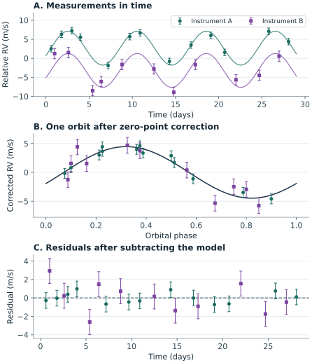

# Chapter 3 — Least Squares and Radial-Velocity Fitting

## 3.1 One orbit, two instruments

Two spectrographs observe a star whose transiting planet has a known period. Each instrument has a different velocity zero point, and their measurements have different uncertainties. For a circular orbit of known period $P$, a useful model is

$$
v(t_i)=A\sin(2\pi t_i/P)+B\cos(2\pi t_i/P)+\gamma_{j(i)}.
$$

The index $j(i)$ identifies the instrument for observation $i$. The sine and cosine allow an arbitrary phase. The velocity semi-amplitude is $K=\sqrt{A^2+B^2}$. Fixing the period makes the prediction linear in $A$, $B$, and the offsets, even though the velocity changes nonlinearly in time. See [The Radial Velocity Method](#Exoplanets/Chapter5) for the eccentric-orbit model.

## 3.2 Build the design matrix

Build one row of a **design matrix** $X$ per observation. List the sine, cosine, and one indicator per instrument in that row. A row for instrument A ends in $(1,0)$, and a row for B ends in $(0,1)$. The model predictions are $X\boldsymbol\beta$, where $\boldsymbol\beta$ holds the coefficients.

With independent Gaussian measurement errors of standard deviation $\sigma_i$, estimate the coefficients by minimizing

$$
\chi^2=\sum_i\left[\frac{v_i-(X\boldsymbol\beta)_i}{\sigma_i}\right]^2.
$$

Divide both the observed velocity and its whole matrix row by $\sigma_i$ before solving. A point with half the uncertainty gets four times the weight. An additional constant column would equal the sum of the two instrument columns, so its coefficient could not be determined independently.

## 3.3 Worked fit: recover a five-metre-per-second signal

The synthetic eight-day orbit below has injected coefficients $A=4$ and $B=3$ m/s, so $K=5$ m/s. The instrument offsets are 2 and −3 m/s. Instrument B has twice the stated uncertainty of A. This exercise assumes a quiet star and a known period.

### Programming exercise: fit and inspect the residuals

Run with Python 3 and NumPy. The noise values are explicit so every run uses the same dataset.

~~~python
import numpy as np

time = np.array([0, 2, 4, 6, 1, 3, 5, 7], dtype=float)
instrument_b = np.array([False] * 4 + [True] * 4)
sigma = np.where(instrument_b, 2.0, 1.0)
angle = 2 * np.pi * time / 8
X = np.column_stack([
    np.sin(angle), np.cos(angle), ~instrument_b, instrument_b,
])
injected = np.array([4.0, 3.0, 2.0, -3.0])
noise = np.array([0.2, -0.4, 0.3, 0.1, -0.5, 0.6, -0.2, 0.3])
velocity = X @ injected + noise

fit, _, rank, singular_values = np.linalg.lstsq(
    X / sigma[:, None], velocity / sigma, rcond=None
)
assert rank == X.shape[1]
residual = velocity - X @ fit
print(f"K = {np.hypot(fit[0], fit[1]):.2f} m/s")
print(f"Offsets = {fit[2]:.2f}, {fit[3]:.2f} m/s")
print(f"Chi-squared = {np.sum((residual / sigma)**2):.2f}")
~~~

The fitted amplitude is close to 5 m/s. Set the noise to zero and verify that the fit recovers the injected coefficients. Next, set the times to just one repeated phase per instrument. The matrix loses rank because the observations cannot distinguish the orbital signal from the instrument offsets. Additional visits at the same phase do not resolve that degeneracy.

<figure class="orbit-figure">
  
  <figcaption>A separate synthetic example with irregular observing times. The top panel shows the velocity zero points. The middle panel shows the shared orbit after offset correction. The bottom panel shows the residuals. From <a href="/book.html?book=Exoplanets#Chapter5">Exoplanets, Chapter 5</a>.</figcaption>
</figure>

## 3.4 What the optimizer cannot fix

Use a QR- or singular-value-based least-squares solver rather than explicitly inverting the normal equations. Forming $X^\mathsf{T}X$ squares the condition number, making poorly separated coefficients harder to recover numerically. Inspect the rank and singular values of the weighted matrix. An observing program with gaps in orbital phase can constrain some combinations of parameters well and leave others essentially free.

When period or eccentricity is unknown, search over those parameters and solve for the linear coefficients at each trial where the model permits it. Daily and seasonal observing patterns can create aliases, so compare the best periods at the actual observing times. If stellar variability correlates measurement errors, the simple diagonal weights need to be replaced by a covariance model. Look at the time series, the phase-folded curve, and the residuals before treating the fitted semi-amplitude as a planet mass. [Dawson & Fabrycky (2010)](https://doi.org/10.1088/0004-637x/722/1/937) · [Fulton et al. (2018), RadVel](https://doi.org/10.1088/1538-3873/aaaaa8) · [Statistics: Likelihood and Uncertainty](#Statistics/Chapter3)
