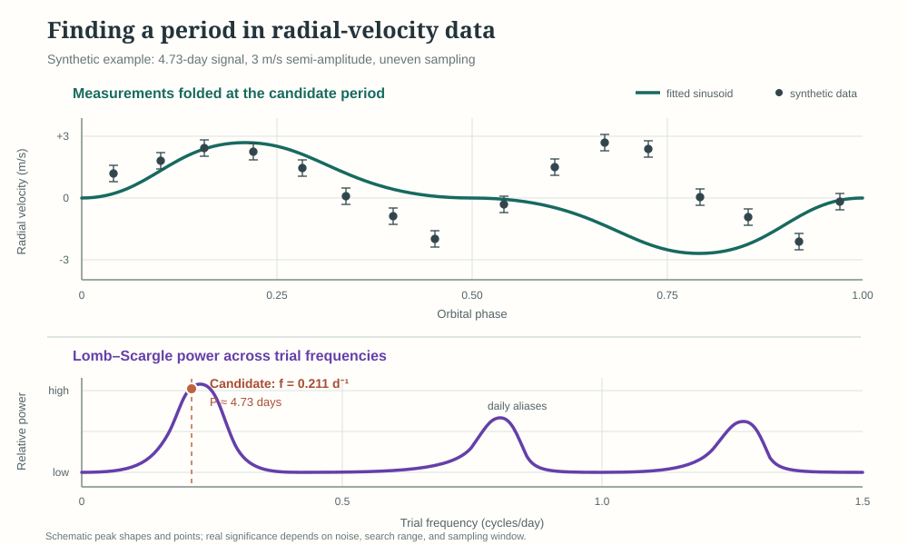

# Chapter 4 — Lomb–Scargle Periodograms

## 4.1 A period hidden in uneven observations

Radial-velocity measurements rarely arrive at evenly spaced times. Weather, daylight, telescope scheduling, and instrument maintenance leave gaps. A Fourier transform assumes a regular sampling grid, so applying it directly to these observations can create misleading results. A **periodogram** instead measures how well periodic models match the data as a function of trial frequency.

The Lomb–Scargle method is a least-squares fit of sine waves to the observed times. At each trial frequency, it asks whether adding a periodic signal improves the fit beyond a constant baseline. It works naturally with uneven sampling and can incorporate measurement uncertainties. It does not remove aliases, stellar variability, or instrumental trends; those remain questions for the model and the observing window. [Lomb (1976)](https://doi.org/10.1007/BF00648343) · [Scargle (1982)](https://doi.org/10.1086/160554)

<figure class="orbit-figure">
    
    <figcaption><strong>From radial velocities to a candidate period.</strong> The upper panel shows synthetic observations folded at the injected 4.73-day period. The lower panel marks the corresponding frequency and daily aliases. The plot is schematic, not observed data; a peak requires significance tests and checks against stellar activity and the observing window.</figcaption>
</figure>

## 4.2 Fit a sinusoid at each frequency

Suppose measurements $y_i$ are taken at times $t_i$, with independent uncertainty $\sigma_i$. At a trial frequency $f$, fit

$$
y(t_i)=c+A\sin(2\pi f t_i)+B\cos(2\pi f t_i).
$$

The offset $c$ is fitted at every frequency. This is called a **floating-mean** or generalized Lomb–Scargle model. The sine and cosine coefficients allow any phase; together they give amplitude $K=\sqrt{A^2+B^2}$. The weighted residual statistic is

$$
\chi^2(f)=\sum_i\left[
\frac{y_i-c-A\sin(2\pi f t_i)-B\cos(2\pi f t_i)}{\sigma_i}
\right]^2.
$$

Let $\chi_0^2$ be the weighted residual statistic for the best constant-only fit. One useful normalized power is

$$
z(f)=1-\frac{\chi^2(f)}{\chi_0^2}.
$$

With this definition, zero means the sinusoid did not improve the fit, and larger values mean a larger fractional reduction in weighted residuals. Other software uses different normalizations, so a power value is meaningful only alongside the convention that produced it. [Zechmeister & Kürster (2009)](https://doi.org/10.1051/0004-6361:200811296) · [VanderPlas (2018)](https://doi.org/10.3847/1538-3881/aaae40)

Because $c$, $A$, and $B$ enter linearly when $f$ is fixed, each trial is a small weighted linear least-squares problem. Divide each design-matrix row and observed value by $\sigma_i$ before solving. Avoid explicitly inverting the normal equations; QR- or singular-value-based least squares is more stable.

## 4.3 Frequency grids and aliases

Let $T=t_{\max}-t_{\min}$ be the observing baseline. Frequency features narrower than roughly $1/T$ are difficult to resolve. A trial grid should sample peaks more finely than this scale, but adding more grid points does not add information to the observations. The grid's upper frequency should be chosen using the cadence, exposure duration, and expected signal, not by blindly applying the evenly sampled Nyquist formula. Irregular sampling has no single universal Nyquist limit.

The observing schedule itself has a **window function**. Repeated nightly observations, seasonal visibility, and long gaps can place power at frequencies offset from the true signal. For a strong signal at $f_0$, aliases often appear near

$$
f_{\rm alias}\simeq |f_0\pm n f_{\rm window}|,
$$

where $f_{\rm window}$ is a prominent frequency in the sampling pattern and $n$ is an integer. A one-day observing cadence commonly creates daily aliases. A tall peak is therefore a candidate period, not proof that the source varies at that period. Plot the measurements against time, inspect the window function, and compare plausible alias fits at the actual observation times. [Dawson & Fabrycky (2010)](https://doi.org/10.1088/0004-637X/722/1/937)

## 4.4 A peak is not yet a detection

The largest periodogram value is selected from many trial frequencies. Its significance is not the same as the significance of a single, preselected frequency. A **false-alarm probability** asks how often noise under a specified null model would produce a peak at least this large somewhere in the searched range. Its value depends on the noise assumptions, frequency range, and effective number of independent trials.

White Gaussian noise with correctly estimated uncertainties is a useful starting model, not a universal description of astronomical data. Stellar rotation and activity, correlated instrument errors, outliers, and long-term trends can all produce coherent-looking peaks. If the noise is correlated, a simple weighted sinusoid fit may report overly optimistic significance. Bootstrap or simulation checks should preserve important features of the observing schedule and noise model. For radial velocities, compare the candidate signal with activity indicators, fit competing planets and trends, and inspect residuals. [Statistics: Likelihood and Uncertainty](#Statistics/Chapter3) · [The Radial Velocity Method](#Exoplanets/Chapter5)

## 4.5 Programming exercise: recover a signal with nightly sampling

This experiment creates a synthetic radial-velocity signal with a period of 4.73 days, observed on an uneven subset of nights. It fits an offset and sinusoid at each trial frequency using NumPy's least-squares solver. Python 3, NumPy, and Matplotlib are required. The injected amplitude is 3 m/s and the per-observation uncertainty is 1.5 m/s. The strongest periodogram peak should lie close to 4.73 days; nearby alias peaks may also appear.

<div data-level="201">

Generate the observing times and noisy measurements. The fixed random seed makes the example repeatable.

```python
import numpy as np
import matplotlib.pyplot as plt

rng = np.random.default_rng(2026)
nights = np.arange(90)
observed_nights = nights[rng.random(nights.size) < 0.65]
time = np.sort(observed_nights + rng.uniform(0.1, 0.5, observed_nights.size))

true_period = 4.73
uncertainty = np.full(time.size, 1.5)
velocity = (
    10.0
    + 3.0 * np.sin(2 * np.pi * time / true_period + 0.4)
    + rng.normal(0.0, uncertainty)
)
```

Compute the constant-only reference fit, then fit a floating-mean sinusoid at every trial frequency. The resulting power is the fractional reduction in weighted $\chi^2$.

```python
weights = 1 / uncertainty**2
weighted_mean = np.sum(weights * velocity) / np.sum(weights)
chi_squared_null = np.sum(((velocity - weighted_mean) / uncertainty) ** 2)

frequency = np.linspace(1 / 90, 2.0, 10_000)
power = np.empty(frequency.size)
for index, trial_frequency in enumerate(frequency):
    angle = 2 * np.pi * trial_frequency * time
    design = np.column_stack((np.ones(time.size), np.sin(angle), np.cos(angle)))
    coefficients, _, _, _ = np.linalg.lstsq(
        design / uncertainty[:, None], velocity / uncertainty, rcond=None
    )
    residual = (velocity - design @ coefficients) / uncertainty
    chi_squared = np.sum(residual**2)
    power[index] = 1 - chi_squared / chi_squared_null

best_index = np.argmax(power)
best_period = 1 / frequency[best_index]
print(f"Highest peak period: {best_period:.3f} days")
```

Display the periodogram with period on the horizontal axis. A reversed axis is a common convention: long periods appear to the left, short periods to the right.

```python
period = 1 / frequency
plt.plot(period, power, color="#176a60")
plt.axvline(true_period, color="#a75814", linestyle="--", label="Injected period")
plt.xlim(30, 0.5)
plt.xlabel("Trial period (days)")
plt.ylabel("Fractional reduction in weighted chi-squared")
plt.legend()
plt.tight_layout()
plt.show()
```

**Check your result.** Is the injected period the highest peak, and what other peaks are visible? The largest peak should be near 4.73 days. Other peaks can arise because observations occur at roughly daily intervals. To check a candidate, fold the measurements on the proposed period and compare the fit and residuals with those of its aliases. Increasing the number of trial frequencies makes the plotted curve smoother, but cannot distinguish periods that the observing baseline and schedule do not resolve.

</div>

## References

- Lomb, N. R. (1976), "Least-squares frequency analysis of unequally spaced data," [Astrophysics and Space Science, 39, 447](https://doi.org/10.1007/BF00648343).
- Scargle, J. D. (1982), "Studies in astronomical time series analysis. II. Statistical aspects of spectral analysis of unevenly spaced data," [The Astrophysical Journal, 263, 835](https://doi.org/10.1086/160554).
- Zechmeister, M. & Kürster, M. (2009), "The generalised Lomb-Scargle periodogram," [Astronomy & Astrophysics, 496, 577](https://doi.org/10.1051/0004-6361:200811296).
- VanderPlas, J. T. (2018), "Understanding the Lomb–Scargle Periodogram," [The Astronomical Journal, 156, 98](https://doi.org/10.3847/1538-3881/aaae40).
- Dawson, R. I. & Fabrycky, D. C. (2010), "Radial Velocity Planets De-aliased," [The Astrophysical Journal, 722, 937](https://doi.org/10.1088/0004-637X/722/1/937).